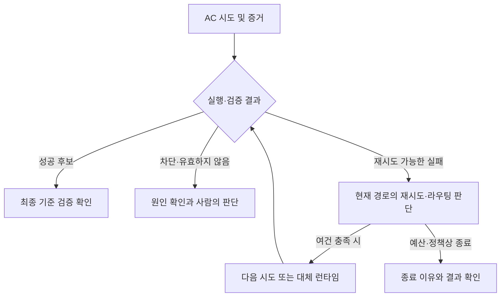

# AC 실행 실패와 재시도 판단

!!! warning "판본과 검증 범위"
    별도 표시가 없으면 이 안내는 제품 소스 [`722172ef`](https://github.com/Q00/ouroboros/tree/722172ef096767583679d04aef5e847458fee6b2)를 기준으로 합니다. 제품 main [`592c667f`](https://github.com/Q00/ouroboros/tree/592c667f076c3dad7ef68d7844e91480d80135d0), 공개 패키지 `0.59.9`, 설치한 호스트와 MCP 서버는 각각 다른 판본일 수 있습니다. 기존 합성·대역 시험은 명시된 조건에 한정되며 실제 모델·외부 서비스·모든 호스트의 실행을 입증하지 않습니다. 현재 설치의 도움말과 [제품 문서](https://github.com/Q00/ouroboros/tree/592c667f076c3dad7ef68d7844e91480d80135d0/docs)를 대조하고 구판 동작이 같다고 가정하지 마세요.

기준: 2026-11-04, Ouroboros 고정 소스 [`722172ef096767583679d04aef5e847458fee6b2`](https://github.com/Q00/ouroboros/tree/722172ef096767583679d04aef5e847458fee6b2). 이 안내는 [병렬 실행기](https://github.com/Q00/ouroboros/blob/722172ef096767583679d04aef5e847458fee6b2/src/ouroboros/orchestrator/parallel_executor.py), [재시도 조건](https://github.com/Q00/ouroboros/blob/722172ef096767583679d04aef5e847458fee6b2/src/ouroboros/orchestrator/retry_hints.py), [대체 런타임 결정](https://github.com/Q00/ouroboros/blob/722172ef096767583679d04aef5e847458fee6b2/src/ouroboros/orchestrator/cross_harness_redispatch.py)을 기준으로 한다. 설치한 다른 버전이나 개별 런타임의 동작은 다를 수 있다. 실제 모델·외부 도구 호출은 이 문서 작성 중 시험하지 않았다.

AC는 Seed의 수용 기준이다. 워커 시도의 실패, 해당 AC의 최종 상태, 실행 전체의 정식 평가와 Ralph 세대는 서로 다르다. 재시도 횟수가 남았다는 사실은 실패가 복구 가능하거나 작업이 안전하다는 증거가 아니다. [상태 조회](/docs/progress-detail/), [평가·진화](/docs/evaluation-evolution-detail/), [복구](/docs/recovery-detail/)를 함께 읽는다.

도식이 화면보다 넓으면 도식 안에서 좌우로 스크롤한다.

## 실패를 읽는 순서

1. 실제 세션·execution·AC와 작업 디렉터리, 각 attempt의 결과와 마지막 오류를 확인한다. 연결 끊김과 실제 시도 종료를 구분하고 살아 있는 작업을 중복 시작하지 않는다.
2. verifier의 `failure_class`, `retry_admission`, 실행된 검증 명령·종료 상태·산출물 및 `execution.ac.attempt_judged` 기록을 함께 본다. 증거 부족, 재생된 검사 실패, 접근 권한·설정 차단, 범위 이탈이나 시간 초과는 다른 원인이다. 분류 이름은 진단 단서이며 실제 원인을 자동으로 증명하지 않는다. [실패 분류 구현](https://github.com/Q00/ouroboros/blob/722172ef096767583679d04aef5e847458fee6b2/src/ouroboros/orchestrator/failure_taxonomy.py).
3. `execution.ac.recovery_exhausted`의 종료 이유와 대체 런타임 상태, `execution.ac.alt_harness_redispatched`의 from/to 및 이유가 있는지 확인한다. 이벤트의 부재만으로 다른 모든 경로의 시도가 없었다고 단정하지 않는다. 로그·이벤트에는 작업 내용이 있을 수 있으므로 공유 전 민감정보를 제거한다. [이벤트 조회](/docs/query-projections-detail/).
4. 마지막으로 실제 작업공간의 변경과 검증 결과를 확인한다. 작업자 성공 응답이나 재시도 시작은 원래 목표의 완료 판정이 아니다. 실행된 검사 없이 얻은 평가 결과의 한계는 [평가 안내](/docs/evaluation-evolution-detail/)를 따른다.

## 예산과 실행 경로

`execution.ac_retry_attempts`의 설정 모델 기본값은 **2**이며 실패 AC의 재배정 상한이다. 0이면 해당 배치 재시도를 쓰지 않는다. 단 이것은 모든 모델 호출이나 전체 시도 수의 상한이 아니다. 프로바이더 자체 재시도, 정체 처리, 분해된 자식, 별도 평가·진화와 다른 라우팅 경로가 더 있을 수 있다. 실행 시작 시 보존된 계약과 실제 적용값을 확인한다. [설정 색인](/docs/config-reference-detail/).

기존 배치 경로에서는 재시도 가능한 실패만 다시 보낸다. `BLOCKED`·`INVALID`, 일부 명시적 설정 오류 등은 그 재시도 대상으로 취급하지 않는다. 같은 실패 분류가 반복되면 남은 횟수 전에 멈출 수 있다. 단 다음 예약 시도에서 런타임이 실제로 강제할 수 있는 **다른 모델로의 상향**이 남아 있으면 이 조기 종료를 미룰 수 있다. rate limit 대기는 결과와 배치에 따라 적용되므로 무조건 즉시 실패로 추정하지 않는다. [재시도 구현](https://github.com/Q00/ouroboros/blob/722172ef096767583679d04aef5e847458fee6b2/src/ouroboros/orchestrator/parallel_executor.py).

무활동 정체는 별도 경로다. 이 판본의 기본 상수는 활동 없는 900초와 최대 두 번의 정체 재시도지만, 실제 활성 라우팅 경로에 따라 처리와 예산이 다르다. 특히 조건을 만족해 활성화된 **bounded route**는 저장된 시도 판정과 한정된 route 집합으로 복구를 관리하며 위의 단순 재시도 횟수·legacy 대체 경로를 그대로 적용하지 않는다. 저장된 bounded-route 증거가 있는데 해당 라우팅을 다시 사용할 수 없으면 임의로 legacy 경로로 낮추지 않고 오류를 낸다. 따라서 숫자를 합산해 전체 비용이나 복구 시간을 확정하지 않는다.

실패 분류 모듈에는 과거 통합 전 상태를 기술하는 오래된 도입부가 남아 있다. 개별 정책표만 보고 모든 실패가 반드시 그 행동을 한다고 가정하지 말고, 이 판본의 실제 호출 경로와 verifier의 `retry_admission`·반환 결과를 확인한다. 과대 작업이라는 **근거 있는 `TOO_BIG` bounce**만 검증된 분해 경로에 들어갈 수 있으며, 막연한 stall이나 범위 이탈만으로 자동 분해를 보장하지 않는다.

## 다른 런타임 재배정과 N-version

이 판본의 일반 runner에서 cross-harness 재배정은 기본 꺼짐이다. `execution.cross_harness_redispatch`라는 저장 설정이 보여도, 실제 loader는 `OUROBOROS_CROSS_HARNESS_REDISPATCH`의 명시적 프로세스 환경 플래그만 읽고 이 저장 값을 동의로 사용하지 않는다. 실행 환경의 값과 시작 당시 계약을 확인한다. [설정 loader](https://github.com/Q00/ouroboros/blob/722172ef096767583679d04aef5e847458fee6b2/src/ouroboros/config/loader.py).

활성화된 legacy 경로에서 같은 런타임 복구가 소진되거나 조기 종료된 뒤에도 모든 실패를 바꾸지는 않는다. 근거상 허위 참조 의심, 정체 재시도 소진 또는 과부하·rate-limit 소진으로 판단된 경우 중 사용 가능하고 다른 실행 런타임이 있어야 한다. 과부하는 오류 문자열의 best-effort 패턴 판정이다. 이 경로는 같은 AC에 **최대 한 번** 다른 런타임을 시도한다. `BLOCKED`·`INVALID` 같은 권한/허용 실패를 다른 런타임으로 우회하는 보장이 아니다. 활성 bounded-route 경로에서는 이 legacy hook이 그대로 선행하지 않는다.

대체 시도는 **같은 작업공간**에서 실행될 수 있다. 대체 실행이 일반 실패 결과를 반환하면 구현은 그 실패와 작업공간 변경 가능성을 보고한다. 다만 대체 실행 과정에서 인프라 예외가 발생하거나 결과가 없으면 hook은 원래 실패 경로로 돌아갈 수 있다. 따라서 최종 결과에 대체 런타임이 표시되지 않는 것만으로 대체 시도가 파일을 건드리지 않았다고 판단하지 않는다. 재배정 이벤트는 시작의 기록이지 성공 증거가 아니다. 실제 결과·로그·worktree·검증과 외부 효과를 확인한다.

`execution.n_version_tournament`와 관련 환경변수·모델 설정은 존재하지만, 이 커밋의 [N-version 모듈](https://github.com/Q00/ouroboros/blob/722172ef096767583679d04aef5e847458fee6b2/src/ouroboros/orchestrator/n_version_tournament.py)은 **scaffolding이며 live AC trigger에 연결되지 않았다**고 명시한다. 해당 설정을 켜면 병렬 토너먼트가 실제 시작된다고 안내하지 않는다. 모듈의 worktree·winner 선택 함수 단위 테스트는 실제 런타임 병렬 실행의 증거가 아니다.

## 외부 효과와 재개

같은 작업이나 다른 런타임의 재시도는 중복 결제·발송·예약 등 외부 효과를 되돌리거나 정확히 한 번 수행한다고 보장하지 않는다. 결과가 불명확한 외부 행동은 먼저 실제 대상 상태와 사용자 권한을 확인하고, 자동 재실행보다 확인 대기를 선택한다. 사용 가능한 도구와 승인 경계는 실행 환경이 별도로 강제해야 한다. 재개 전에는 기존 시도·branch·효과를 보존하고 [복구 안내](/docs/recovery-detail/)의 종결·프로세스 소유자 조건을 확인한다.

**검증 범위:** 위 설명은 고정 소스와 관련 경로가 동일한 제품 소스 [`4ff13e8`](https://github.com/Q00/ouroboros/tree/4ff13e838bd332693c9b959fd22861dda5a1d525)을 정적으로 대조했다. 임시 HOME/TMPDIR·telemetry 비활성 조건에서 기존 `test_cross_harness_redispatch.py`, `test_alt_harness_hook.py`, `test_n_version_tournament.py`의 **55개 테스트가 통과**했다. 테스트는 대역·임시 Git 등을 사용하며 실제 공급자·모델·외부 효과·전체 실패 조합이나 OS 네트워크 격리를 검증하지 않는다.

## 수용 기준 실행 capsule과 복구 진단

고정 source의 `ACExecutionCapsule`은 하나의 물리적 AC 세션에 대해 orchestrator가 만드는 **런타임 중립 내부 계약**이다. 실행·AC·시도·세그먼트 식별자, 정규화된 workspace, Seed 목표와 해당 기준, 성공 계약, 참조 목록과 문맥 예산을 묶는다. 이것은 사용자가 임의로 작성하는 공개 YAML이나 OS 격리 컨테이너가 아니다. 성공 계약이 기대하는 artifact 경로가 현재 workspace에서 표현될 수 없으면 컴파일 단계에서 `unmaterializable_success_contract`로 거부할 수 있다. [capsule 구현](https://github.com/Q00/ouroboros/blob/722172ef096767583679d04aef5e847458fee6b2/src/ouroboros/orchestrator/ac_execution_capsule.py).

컴파일은 workspace와 Seed 목표에 대한 필수 참조를 만들고, 성공 계약이 있으면 검증 gate 참조도 추가한다. 기대 artifact와 선행 작업 참조는 선택적 문맥으로 추가된다. 참조 블록은 기본 12,000자 예산을 사용하며, 넘치는 선택적 참조는 생략 수와 digest로 요약될 수 있다. 참조는 원문과 같은 것이 아니므로 모델이 선행 작업 전체를 받았다고 가정하지 않는다. manifest는 workspace·목표·기준·성공 계약 등 원문 대신 digest를 포함하고 fingerprint를 계산하지만, 이는 비밀 보관이나 암호화 보장이 아니다. 실제 workspace·Seed·이벤트·검증 기록이 별도로 필요하다.

재개 시 capsule fingerprint 및 runtime handle의 소유 범위가 기존 권위와 불일치하면 코드가 거부할 수 있다. `execution.ac.capsule.compiled`와 dispatch 관련 이벤트를 확인해 어느 AC·시도에서 실패했는지 살펴보고, 기존 workspace·Seed·이벤트를 보존한 채 [이벤트 계약](/docs/event-contract-detail/)과 위 재개 절차를 따라 진단한다. fingerprint를 임의로 바꾸거나 이벤트를 편집해 오류를 우회하지 않는다. 버전 2 capsule의 재개 호환 분기는 존재하지만 모든 이전 릴리스·provider 세션이 재개된다는 보장은 아니다. [재개 바인딩](https://github.com/Q00/ouroboros/blob/722172ef096767583679d04aef5e847458fee6b2/src/ouroboros/orchestrator/ac_execution_capsule.py)과 [런타임 핸들 관리](https://github.com/Q00/ouroboros/blob/722172ef096767583679d04aef5e847458fee6b2/src/ouroboros/orchestrator/ac_runtime_handle_manager.py)를 참조한다.

2026-11-04 고정 source와 동일한 두 구현 파일을 확인하고 합성 단위 테스트 네 개에서 fingerprint 안정성·권위 변경, 선행 결과의 참조와 예산 초과 참조 생략을 확인했다. 실제 provider 실행·중단 복구·외부 효과·모든 capsule 버전 조합은 시험하지 않았다.
