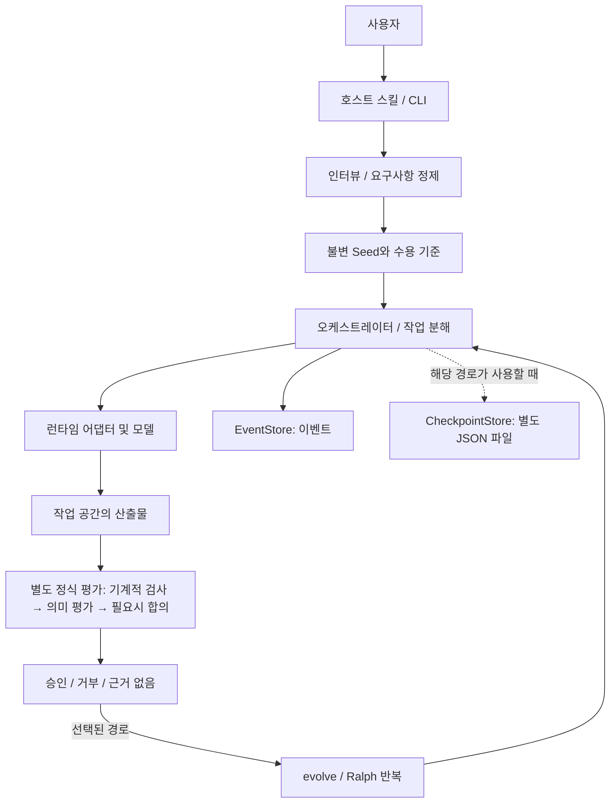
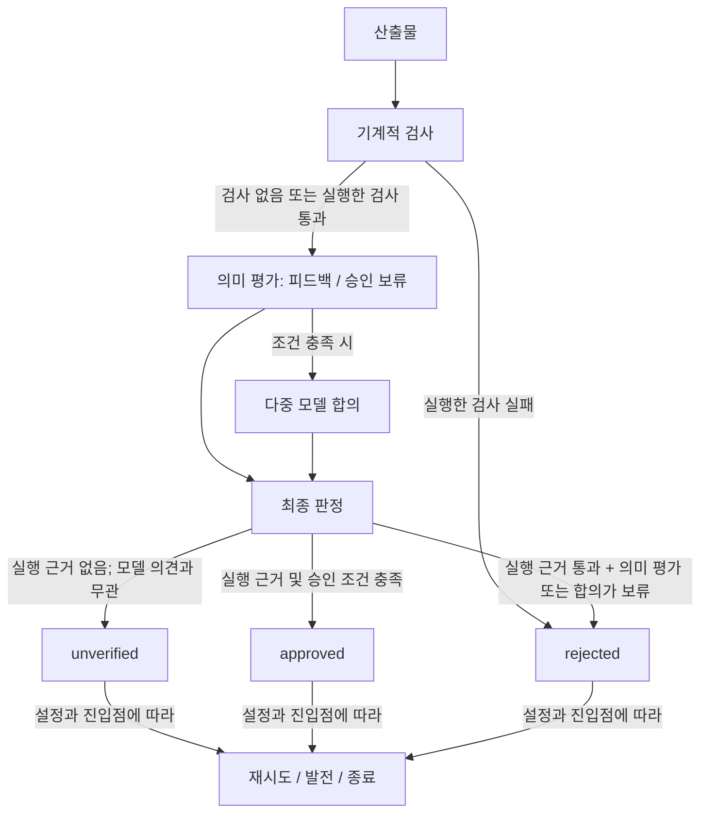
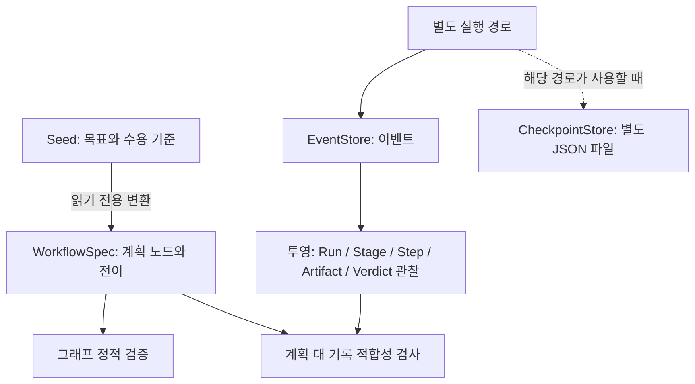

# 구조와 실행 흐름

!!! warning "판본과 검증 범위"
    이 문서의 상세 설명과 합성 관찰은 별도 표시가 없으면 2026-11-04 조사한 제품 소스 [`722172ef`](https://github.com/Q00/ouroboros/tree/722172ef096767583679d04aef5e847458fee6b2) 기준입니다. 제품 main [`592c667f`](https://github.com/Q00/ouroboros/tree/592c667f076c3dad7ef68d7844e91480d80135d0), 공개 패키지 `0.59.9`, 호스트 플러그인·MCP 서버는 별도 판본입니다. 합성·대역 사례는 표시된 조건에 한정되며 실제 모델, 운영 데이터 또는 전체 호스트를 검증하지 않습니다. 현재 설치의 도움말과 [제품 문서](https://github.com/Q00/ouroboros/tree/592c667f076c3dad7ef68d7844e91480d80135d0/docs)를 대조하고 구판과 동일하게 동작한다고 가정하지 마세요.

기준: 2026-11-04 확인한 [upstream 722172ef](https://github.com/Q00/ouroboros/tree/722172ef096767583679d04aef5e847458fee6b2), 비교 설치 패키지 0.59.9 (source와 동일한 빌드라고 검증하지 않음). 아래는 소스·원본 문서에 근거한 모델이며 모든 호스트에서 실제 실행한 결과는 아니다. 호스트 플러그인의 스킬 호출과 별도 CLI 명령은 서로 다른 진입점이다.

첫 도식은 화면이 좁으면 좌우로 스크롤해 읽는다. 도식은 사이트에 포함된 Mermaid 스크립트를 불러와야 그림으로 표시된다. 스크립트가 차단되거나 실행되지 않으면 아래 코드가 원문으로 보일 수 있다. 핵심 흐름은 사용자 → 호스트·인터뷰 → Seed → 오케스트레이터·런타임 → 산출물이며, 이벤트와 체크포인트는 별도 저장 경로다. 정식 평가는 산출물을 별도로 판단하고 선택된 경로에서 반복으로 이어진다. 모든 진입점이 이 순서를 전부 거치는 것은 아니다.

실제 경로는 진입점과 설정에 따라 달라진다. 모든 호출이 모든 상자를 거친다고 가정하지 않는다. 특히 `auto`는 [별도 계약](https://github.com/Q00/ouroboros/blob/722172ef096767583679d04aef5e847458fee6b2/docs/auto-runtime-semantics.md)을 확인하고, `evolve`와 `ralph`는 명시된 진입점에서 사용한다.

도식의 정식 평가는 실행 경로 내부의 AC 조정과 별도다. 실행 중 검사 패키지와 기존 verifier를 조정할 때는 조건에 따라 **시도된 AC가 미검증으로 남은 채 실행상 수용**될 수 있다. 따라서 실행 완료·수용을 보고 정식 평가의 `approved`나 모든 기준의 검사 성공을 추론하지 않는다. `record` 모드는 가상 판정을 기록하며 그 자체가 실행 판정을 바꾸지 않는다. 실제 판정 경로와 기준별 증거·검증 범위를 확인한다. 조건과 예외는 [평가 경로 구분](/docs/evaluation-evolution-detail/) 및 [검사 패키지](/docs/check-package-detail/)를 따른다. 이는 고정 소스의 [AC 조정 정책](https://github.com/Q00/ouroboros/blob/722172ef096767583679d04aef5e847458fee6b2/src/ouroboros/boundary/acceptance.py)을 대조한 설명이며 실제 모델 실행을 시험한 결과는 아니다.

## 경계와 책임

| 계층 | 책임과 점검 지점 |
| --- | --- |
| 호스트 스킬 | 사용자의 목표에 따라 인터뷰, Seed, 실행 등 워크플로를 조합한다. 스킬 이름과 독립 CLI의 동명 명령은 동등한 인터페이스라는 보장이 없다. |
| Seed | 목표·제약·수용 기준을 고정한다. 요구가 바뀌면 기존 결과와 수정된 명세의 관계를 추적한다. [Seed 모델](https://github.com/Q00/ouroboros/blob/722172ef096767583679d04aef5e847458fee6b2/src/ouroboros/core/seed.py), [작성 안내](https://github.com/Q00/ouroboros/blob/722172ef096767583679d04aef5e847458fee6b2/docs/guides/seed-authoring.md). |
| 실행 | `runner_factory.py`에서 공통 러너를 조립하고 진입점이 workspace·요청·호스트 맥락을 전달한다. 런타임은 파일 및 외부 도구에 접근할 수 있으므로 호스트 권한과 프로젝트 범위를 확인한다. [원본 구조](https://github.com/Q00/ouroboros/blob/722172ef096767583679d04aef5e847458fee6b2/docs/architecture.md). |
| 상태 | 이벤트 저장과 체크포인트는 진행 기록을 제공한다. 작업 공간 파일, DB, 백그라운드 프로세스는 별개이므로 한쪽의 존재가 나머지의 지속을 보장하지 않는다. [이벤트 스키마](https://github.com/Q00/ouroboros/blob/722172ef096767583679d04aef5e847458fee6b2/docs/events.md). |
| 평가 | 작업자의 완료, 실행 중 AC 조정, 별도 정식 평가 판정은 다르다. **정식 평가**에서는 실제 실행된 기계적 검사 없이는 `unverified`; 의미 평가와 합의는 승인을 보류할 수 있으나 실행 근거 없이 승인할 수 없다. 실행 중 AC 조정은 위의 별도 조건을 따른다. [평가 계약](https://github.com/Q00/ouroboros/blob/722172ef096767583679d04aef5e847458fee6b2/docs/guides/evaluation-pipeline.md). |

## 정식 평가와 반복

위 도식은 평가가 판정까지 도달한 경우를 요약한다. 실제 [평가 파이프라인](https://github.com/Q00/ouroboros/blob/722172ef096767583679d04aef5e847458fee6b2/src/ouroboros/evaluation/pipeline.py)은 산출물 수집이 불완전하면 부분 결과를 평가하지 않고 오류를 반환하며, 기계 검사·의미 평가·합의 단계의 처리 오류도 판정 대신 오류로 반환할 수 있다. 따라서 오류나 누락된 응답을 `unverified` 또는 다른 판정으로 자동 해석하지 말고 수집·단계 오류를 먼저 진단한다. 이 구분은 소스 대조이며 실제 모델이나 수집 실패 재현은 수행하지 않았다.

기계 검사가 하나도 실행되지 않아도 의미 평가는 피드백을 위해 실행될 수 있다. 이때 모델의 긍정 판단은 실행 근거를 대신하지 못하며, 모델이 부정 의견을 내더라도 수용 상태는 `rejected`가 아니라 `unverified`다. 실행된 기계 검사 실패는 뒤의 의미 평가를 건너뛰고 거부한다. 여러 AC를 평가할 때 공유 기계 검사를 한 번 실행했다면 그 결과가 각 AC별 전용 검사를 증명하지 않는다. 기계적 명령은 프로젝트 `.ouroboros/mechanical.toml`에서 읽는다. 감지가 실패하거나 검사가 모두 생략되면 실행 증거가 없으므로 통과한 검사로 취급하지 않는다. `detect`는 기존 파일을 그대로 유지하는 경우를 제외하면 백엔드를 초기화하고 프로젝트에 따라 모델을 호출해 파일을 쓴다. 일부 표준 라이브러리 unittest 탐지는 모델 호출 없이 처리된다. `--force`는 기존 파일을 덮어쓴다. `evolve`는 한 단계, `ralph`는 종료 조건까지 반복하는 표면이다. 종료 조건이 수용 기준의 진실을 보장하는 것은 아니므로 산출물과 검증 결과를 직접 확인한다. [반복 안내](https://github.com/Q00/ouroboros/blob/722172ef096767583679d04aef5e847458fee6b2/docs/guides/evolution-loop.md).

## 계획 그래프와 실제 실행 기록

[Workflow IR v1 계약](https://github.com/Q00/ouroboros/blob/722172ef096767583679d04aef5e847458fee6b2/docs/agentos/workflow-ir-v1.md)은 `WorkflowSpec`의 노드·엣지·소유자와 참조 스키마를 표현하고, 끊긴 참조·중복 ID·종료점 도달 가능성 등을 실행 전에 결정적으로 검증하는 **계획과 적합성 검사 경계**다. Seed의 문자열 수용 기준을 읽기 전용 그래프로 옮길 수 있지만, 이 커밋에서 IR 자체가 작업을 디스패치하거나 Seed·기존 `ooo run` 실행을 대체한다는 뜻은 아니다. plugin 노드는 계획에 나타날 수 있어도 그 사실이 플러그인 실행 권한을 부여하지 않는다.

계획 쪽은 Seed를 읽기 전용 WorkflowSpec으로 변환해 그래프를 정적 검증한다. 별도 실행 경로는 EventStore에 이벤트를 기록하고, 사용하는 경로라면 별도 JSON 체크포인트도 남긴다. 이벤트 투영을 계획과 비교해 적합성을 검사한다. 여기서 계획의 유효성, 디스패치 성공, 실제 산출물 존재, 수용 판정은 각각 다른 증거다. 이벤트의 `workflow_id`는 실행 기록을 계획에 연결하지만 완료 이벤트 한 행이 결과의 품질을 증명하지 않는다. Workflow IR 이벤트에는 원시 프롬프트·표준 출력·자격 증명이 아닌 제한된 참조와 힌트가 쓰인다. 상세 필드는 [원본 이벤트 계약](https://github.com/Q00/ouroboros/blob/722172ef096767583679d04aef5e847458fee6b2/docs/events.md)을 따른다.

## 세대와 반복의 인과 관계

진화 경로가 선택되면 이전 Seed·온톨로지와 실행·평가 결과를 Wonder가 미해결 질문으로, Reflect가 다음 세대의 기준·구조 후보로 바꾼다. `evolve`는 한 세대를 진행하는 표면이고 MCP 소유 `ralph`는 조건이 충족될 때까지 단계를 반복한다. OpenCode 플러그인 경로는 동일한 job 핸들을 반환하는 대신 자식 작업에 위임할 수 있다. 생성된 새 기준은 과거 Seed의 판정을 소급 변경하지 않는다. 세대의 수렴·최대 횟수·취소는 **반복 종료 이유**이며 원래 사용자의 수용 기준이 참이라는 증명이 아니다. 다음 결과를 판단할 때 실제 기준과 검사 증거를 다시 대조한다. [진화 안내](https://github.com/Q00/ouroboros/blob/722172ef096767583679d04aef5e847458fee6b2/docs/guides/evolution-loop.md).

## 확장과 통합

[MCP 참조](https://github.com/Q00/ouroboros/blob/722172ef096767583679d04aef5e847458fee6b2/docs/api/mcp.md)는 소비자·서버 양쪽 API를 설명한다. `mcp serve`의 네트워크 바인딩 조건은 [CLI 참조](https://github.com/Q00/ouroboros/blob/722172ef096767583679d04aef5e847458fee6b2/docs/cli-reference.md)를 확인한다. 번들 스킬/에이전트 레지스트리와 사용자 설치형 UserLevel 프로그램은 다른 계층이다. 원본 구조 문서는 제3자 설치 표면을 계획이라고 표시하지만, 같은 커밋의 `cli/commands/plugin.py`에는 `add`, `install` 등이 등록되어 있다. 문서가 오래되었을 가능성이 있으므로 지원 범위는 해당 구현과 설치 버전의 도움말을 확인한다. 격리된 합성 로컬 플러그인 한 개의 발견·설치·신뢰·호출·비활성화를 시험했지만, 실제 외부 플러그인이나 원격 clone을 검증한 것은 아니다. 단계와 시험 조건은 [UserLevel 플러그인 안내](/docs/plugins-detail/)를 참조한다.

## 상태, 실행 경계와 관찰 기록

[이벤트 스키마](https://github.com/Q00/ouroboros/blob/722172ef096767583679d04aef5e847458fee6b2/docs/events.md)를 읽을 때 이벤트 이름만으로 수용 결과를 추론하지 않는다.

| 관찰 | 뜻 | 운영상 판단 |
| --- | --- | --- |
| `execution.ac.completed`의 `passed` | 과거 이름을 유지하는 **워커 실행 단위 완료** 기록 | 정식 수용 기준 통과가 아니다. 별도 평가의 `ACResult`와 실제 증거를 확인한다. |
| `execution.ac.attempt.dispatched` | 해당 시도에서 런타임 제공자 진입 경계를 기록 | 이미 외부 효과가 있었을 수 있다. 단순한 사용자 요청 접수와 구분한다. |
| `execution.ac.dispatch.sealed` | 외부 효과가 발생했을 가능성이 있으나 종료 결과가 아직 내구 저장되지 않은 경계 | 종료 이벤트가 나중에 이를 대체할 수 있다. 봉인된 시도를 자동 재발송해 중복 작업을 만들지 않는다. |
| `mcp.job.acceptance_pending_observed` | detached 시작의 등록 기한에 job 등록이 아직 관찰되지 않았다는 별도 영속 기록 | 작업 수락·현재 생존·재시도 허가가 아니다. 실제 job 이벤트가 우선한다. 최초 응답이 `pending_receipt_persisted=false`라면 기록 자체도 영속되지 않았을 수 있다. |
| `mcp.job.created`의 소유자 정보 | 생성 당시의 프로세스 식별 정보 | Linux 소유자 식별이 누락되거나 지원되지 않으면 종료했다고 증명할 수 없다. 기존 PID 재사용 가능성을 포함해 현재 소유 상태를 확인한다. |

EventStore는 이벤트를 저장하고 조회 경로는 그 이벤트로 투영을 계산한다. 별도의 `CheckpointStore`를 사용하는 경로의 체크포인트는 EventStore의 행이 아닌 JSON 파일이다. 어느 한 저장소도 프로젝트 파일과 워커 프로세스를 대신 보존하지 않는다. 장기 실행을 복원할 때는 **기록된 상태**, 소유 프로세스와 실제 런타임, 작업 디렉터리·파일을 각각 확인한다. 기동 대기·중복 위험·부분 실패가 있으면 [진행상태](/docs/progress-detail/)와 [복구](/docs/recovery-detail/)를 이용해 동일 ID를 먼저 조사한다. 체크포인트 위치와 범위는 [생명주기](/docs/lifecycle-detail/)를, 이벤트별 필드와 버전은 고정 원본을 따른다.

내부 확장 관점에서 `AgentRuntimeContext`는 EventStore·런타임/LLM 백엔드·MCP 브리지·제어 핸들을 넘기는 경계이고, `Directive`는 워크플로 제어 어휘, `ControlContract`는 해당 결정의 검증된 기록, `ControlBus`는 인프로세스 전달 표면이다. 이들이 있다는 사실만으로 모든 프로세스가 재시작 뒤 내구적 pause/resume을 지원한다거나 모든 로그 이벤트에 실시간 구독자가 반응한다고 단정하지 않는다. 원본 [런타임 계약](https://github.com/Q00/ouroboros/blob/722172ef096767583679d04aef5e847458fee6b2/docs/agentos/runtime-contract.md)은 이벤트 생산자마다 기록 실패와 원자성 정책이 다르다고 설명한다. 구성 요소를 변경하거나 통합할 때는 그 생산자와 테스트를 개별 확인한다.

작업자 간 파일 전달에 쓰는 artifact 본문과 EventStore의 기록도 동일 저장소가 아니다. 원본 구조 문서는 artifact 본문을 별도 `artifacts.db`에 저장하고 EventStore는 제한된 envelope를 가진다고 설명한다. DB 한 개만 복사하면 전체 산출물이 보존된다고 가정하지 말고 저장 위치·접근권·백업과 삭제 정책을 각 경로에서 확인한다. [원본 구조](https://github.com/Q00/ouroboros/blob/722172ef096767583679d04aef5e847458fee6b2/docs/architecture.md).
