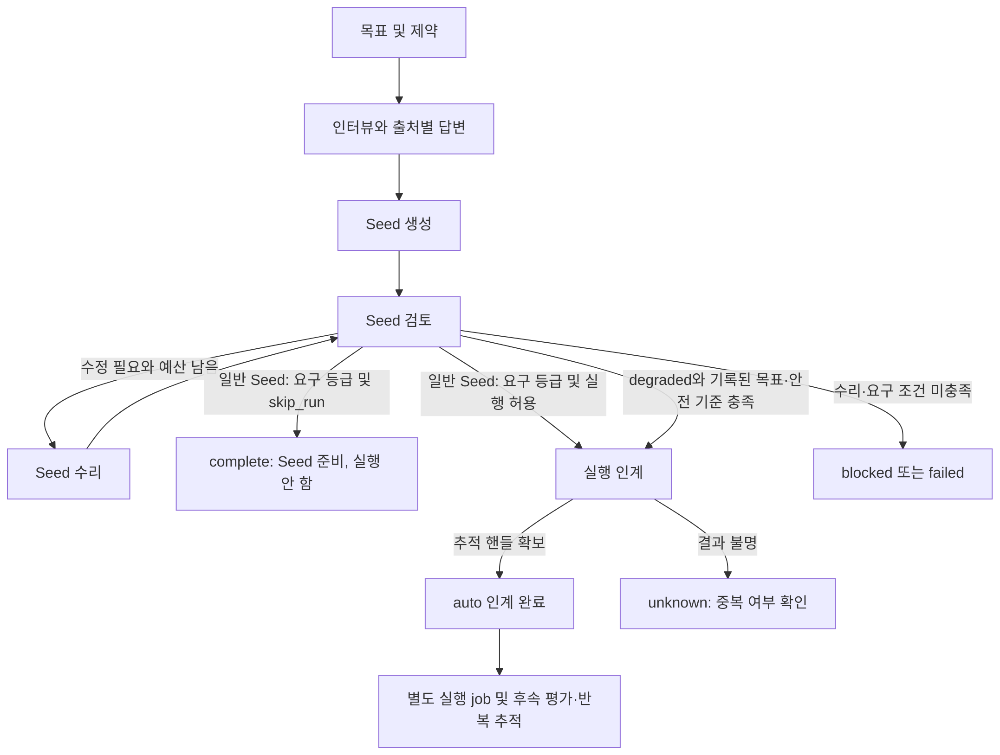

# Auto: 명세 생성에서 실행 인계까지

기준: 2026-11-04, Ouroboros source [`722172ef096767583679d04aef5e847458fee6b2`](https://github.com/Q00/ouroboros/tree/722172ef096767583679d04aef5e847458fee6b2). [auto 스킬](https://github.com/Q00/ouroboros/blob/722172ef096767583679d04aef5e847458fee6b2/skills/auto/SKILL.md), [상태 모델](https://github.com/Q00/ouroboros/blob/722172ef096767583679d04aef5e847458fee6b2/src/ouroboros/auto/state.py), [MCP 핸들러](https://github.com/Q00/ouroboros/blob/722172ef096767583679d04aef5e847458fee6b2/src/ouroboros/mcp/tools/auto_handler.py)와 [실행 인계](https://github.com/Q00/ouroboros/blob/722172ef096767583679d04aef5e847458fee6b2/src/ouroboros/auto/pipeline.py)를 대조했다. 설치된 버전과 연결된 서버의 스키마가 다르면 그 버전을 확인한다. 이 안내 작성 중 실제 auto·모델·외부 도구 실행은 하지 않았다.

**판본 경계:** 아래 세부 동작·기본값·관찰은 위 722판의 source 및 해당 시점에 확인한 독립 CLI 경로에 한정한다. `v0.59.9` 및 main [`592c667f`](https://github.com/Q00/ouroboros/tree/592c667f076c3dad7ef68d7844e91480d80135d0)의 대응 auto skill, state, handler, pipeline 파일을 정적으로 비교했을 때 그 파일들에 차이는 보이지 않았다. 이는 선택한 파일의 비교이며 다른 실행 경로·의존성·호스트 plugin의 동등성을 증명하지 않는다. 현재 호스트·모델의 auto 실행, 재시작 뒤 인계, 외부 효과는 확인하지 않았다. 설치된 서버의 도구 schema와 CLI 도움말을 우선한다. 상태·복구의 세부 ID와 다음 확인은 [진행 상태](/docs/progress-detail/) 및 [복구](/docs/recovery-detail/)를 함께 참조한다.

`ooo auto`는 새 목표에서 인터뷰와 Seed 검토를 거쳐 실행을 인계하는 경로다. 기존 Seed의 실행에는 [실행 경로](https://github.com/Q00/ouroboros/blob/722172ef096767583679d04aef5e847458fee6b2/skills/run/SKILL.md)를 사용한다. 목표 문장에 Seed 파일명을 썼다는 것만으로 기존 Seed의 계보가 이어지지 않는다. 호스트 스킬은 실제 `ouroboros_start_auto` 호출을 요구한다. 필요한 MCP 도구가 없으면 수동 작업을 같은 auto 실행으로 보고하지 않는다. 모델 호출·코드 변경·검증 명령과 외부 도구는 비용이나 부작용을 낼 수 있으므로 실제 작업 경로와 사용자가 허용한 범위를 먼저 확인한다.

도식이 화면보다 넓으면 도식 안에서 좌우로 스크롤한다.

## 시작과 상태 해석

호스트에서 `ooo auto "목표와 제약"`을 요청하면 스킬은 백그라운드 시작 도구를 호출한다. 새 실행에는 비어 있지 않은 `goal`, 재개에는 `resume`의 **auto session ID**가 필요하다. 시작 응답의 `job_id`와 `auto_session_id`를 모두 보존한다. 이후 실행의 `execution_id`, 실행 `session_id`, 후속 Ralph job ID는 별도 식별자다. OpenCode plugin 위임에서 `job_id=None`이면 실제 자식 세션을 추적하며 없는 job ID로 조회하지 않는다. [진행 상태](/docs/progress-detail/), [OpenCode 브리지](/docs/opencode-bridge-detail/), [MCP 입력 색인](/docs/mcp-reference-detail/#ouroboros_start_auto).

직접 MCP 클라이언트에서 `ouroboros_auto`는 같은 입력 스키마의 **대기형** 파이프라인이다. 예를 들어 새 목표는 `{"goal": "실제 목표와 제약", "cwd": "/실제/작업/경로"}`를 MCP 도구 인자로 전달한다. 이는 셸 명령이 아니며, 호출하면 실제 인터뷰·모델 사용과 후속 실행이 발생할 수 있다. 호출 자체가 파이프라인 반환까지 기다려 클라이언트 제한 시간을 넘길 수 있으므로, 장시간 작업은 `ouroboros_start_auto`의 반환 ID와 작업 조회를 우선한다. 대기형 응답의 `meta`와 텍스트로 상태·생성된 ID 및 인계 결과를 확인한다. `blocked`·`failed`는 도구 오류 표시가 되지만, 오류 표시가 없다는 사실만으로 최종 코드 변경과 평가까지 성공했다고 판단하지 않는다. 재개에는 앞서 받은 auto session ID를 `resume`에 전달하고 원래 실행 상태를 확인한다. `_start_auto_lease_token`은 서버 내부 인자이므로 직접 지정하지 않는다. 이 구분은 [고정 핸들러](https://github.com/Q00/ouroboros/blob/722172ef096767583679d04aef5e847458fee6b2/src/ouroboros/mcp/tools/auto_handler.py)의 정적 대조이며 실제 모델 호출이나 클라이언트 timeout을 시험하지 않았다.

`queued`는 접수, `blocked`·`failed`는 반환된 차단·오류이며 도구 호출 실패와 구분한다. `seed_ready`는 내부 인터뷰 완료 결과에 쓰이는 값이다. `skip_run`으로 Seed 준비 뒤 실행을 건너뛴 auto의 최종 phase/status는 `complete`이며, 진행 메시지와 `skip_run`을 함께 확인한다. `detached`는 추적이 필요한 비종결 백그라운드 작업이다. **auto의 `complete`도 실행 핸들 인계를 뜻할 수 있으며 제품이 검증 완료됐다는 뜻이 아니다.** 인계된 실행 job과 별도의 평가·Ralph job의 실제 상태와 결과를 확인한다. `execution.auto_evaluate`·`execution.auto_evolve` 및 호출별 선택에 따라 후속 작업이 없거나 시작되지 않을 수도 있다. [평가·진화](/docs/evaluation-evolution-detail/).

독립 CLI의 `ouroboros status auto AUTO_SESSION_ID`는 현재 phase와 최근 진행, 대기 질문 및 최근 자동 답변 최대 3개를 표시할 수 있다. 이 출력에는 목표·질문·답변의 민감한 내용이 포함될 수 있으므로 공유 전 검토하고 가린다. 출력의 `Terminal: True`는 이 판본에서 `complete`뿐 아니라 `blocked`와 `failed`에도 표시된다. 성공 여부는 phase·오류와 연결된 작업 결과로 구분한다. 격리된 임시 HOME에서 합성 `blocked` 상태와 대기 질문, 자동 답변 4개를 저장하고 실제 CLI로 조회했을 때 종료 0, `Terminal: True`, 대기 질문과 최근 3개 답변이 표시됐다. 실제 사용자 데이터·모델을 사용하지 않았으며 실행 중인 세션과 OS 네트워크 격리는 시험하지 않았다. [상태 출력 구현](https://github.com/Q00/ouroboros/blob/722172ef096767583679d04aef5e847458fee6b2/src/ouroboros/cli/commands/status.py).

호스트가 반환한 `job_observer` 계약과 실제 실행 환경이 제공하는 관찰 방식을 따른다. 시작 영수증이나 창이 닫힌 사실만으로 작업이 살아 있거나 끝났다고 단정하지 않는다. 직렬 소유자가 있는 동안 상태·결과와 연결된 후속 핸들을 확인한다. 직접 CLI의 기본은 실행 인계 결과를 기다리며, `--no-wait`의 in-process 작업은 **CLI 종료 후 지속되지 않을 수 있다**. 지속적인 별도 소유자가 실제로 있는지 확인하지 않고 백그라운드 지속을 약속하지 않는다. [auto CLI](https://github.com/Q00/ouroboros/blob/722172ef096767583679d04aef5e847458fee6b2/src/ouroboros/cli/commands/auto.py).

**조회 저장소와 재개 구분:** 고정 main/release에서 `ouroboros status auto AUTO_SESSION_ID`와 `ouroboros auto --status --resume AUTO_SESSION_ID`는 기본 `~/.ouroboros/data/<AUTO_SESSION_ID>.json`을 읽습니다. EventStore DB나 프로젝트의 trace 파일을 대신 조회하는 명령이 아니며, 이 두 CLI 조회에는 별도 상태 경로 옵션이 없습니다. 원래 실행한 사용자·HOME과 auto ID를 확인하세요. 파일 부재, JSON 손상, 상태 구조·ID 불일치는 오류로 구분되므로 기록을 새로 만들거나 수정해 해결하지 말고 기존 파일을 보존합니다. 조회 오류만으로 원래 실행·연결 job이 없거나 종료됐다고 판단하지 않습니다. `auto --status --resume`의 `--status`를 빼면 조회가 아닌 재개 경로로 들어가 모델 호출·상태 저장·실행 인계가 발생할 수 있습니다. [main 조회 분기](https://github.com/Q00/ouroboros/blob/592c667f076c3dad7ef68d7844e91480d80135d0/src/ouroboros/cli/commands/auto.py#L334-L343) · [release 저장소·파일 검증](https://github.com/Q00/ouroboros/blob/5f5fca90662861201ff0a26f502edd22b272c4c6/src/ouroboros/auto/state.py#L1541-L1607). 이는 정적 소스 대조이며 실제 사용자 상태를 읽거나 재개하지 않았습니다.

독립 CLI가 인계된 실행 job을 기다리는 경로에서는 **job의 `completed`와 실행 성공을 별도로 판정**한다. 고정 구현은 결과 메타데이터의 `status`·`success`를 함께 읽는다. 실행 상태가 `paused`면 auto 결과는 재개 가능한 `blocked`, 명시적 실패 또는 실패 상태면 `failed`다. `success`가 true가 아니고 해석된 실행 상태도 `completed`가 아니면 `blocked`로 남는다. 단 상태 메타데이터가 없으면 job의 `completed`가 기본 상태로 사용되어 `success=true`가 없어도 complete가 될 수 있다. 따라서 이 판정만으로 실제 제품 검증 완료를 주장하지 않는다. 실행 결과를 먼저 확인하고 재개 전 기존 작업과 외부 효과를 대조한다. 관련 기존 대역 테스트 4개가 격리 HOME에서 통과했으며, 실제 모델 실행이나 재개는 시험하지 않았다. [CLI 판정 구현](https://github.com/Q00/ouroboros/blob/722172ef096767583679d04aef5e847458fee6b2/src/ouroboros/cli/commands/auto.py).

MCP `ouroboros_session_status`의 auto 응답에서 Ralph job-mode `meta.ralph.last_event_at`은 이벤트 관찰 전 `null`일 수 있고, 값이 있더라도 벽시계 시각이나 Unix timestamp가 아니다. 고정 소스의 리스너가 이벤트를 관찰할 때 `time.monotonic()` 값을 저장해 전달한다. 절대 날짜로 표시하거나 재부팅·다른 호스트의 값과 비교해 경과 시간을 계산하지 않는다. 이 값만으로 프로세스 생존이나 실행 성공을 판단하지 말고 job 상태와 실제 결과를 확인한다. plugin 위임 등에서는 블록 구조와 필드가 다를 수 있다. [리스너](https://github.com/Q00/ouroboros/blob/722172ef096767583679d04aef5e847458fee6b2/src/ouroboros/auto/listeners.py), [상태 응답](https://github.com/Q00/ouroboros/blob/722172ef096767583679d04aef5e847458fee6b2/src/ouroboros/mcp/tools/query_handlers.py). 정적 소스 대조이며 실제 Ralph job은 시험하지 않았다.

## 자동 답변과 Seed 확인

인터뷰 중 auto는 `conservative_default`, `inference`, `assumption` 등의 출처로 답을 만들 수 있다. 이 답은 사용자가 직접 승인한 사실이 아니다. auto 세션 상태의 `pending_question`과 최근 `auto_answer_log`, 결과의 `assumption_sources`, non-goals와 불확실한 항목을 검토한다. 상태에서 보이는 최근 답은 제한·축약될 수 있으므로 그것만으로 전체 대화를 복원했다고 보지 않는다. Seed의 목표·제약·기준 및 실제 작업 경로를 확인한다. 일반 Seed는 요구 등급(기본 A)과 실행 허용 검토를 통과해야 인계된다. 다만 deadline 복구로 생성된 `degraded` Seed에 요청자의 기록된 목표인 `sourced_scope`가 있으면 미해결 항목을 남긴 채 일반 등급·`may_run` 대신 안전 blocker 기준으로 실행될 수 있다. `sourced_scope`가 없으면 실행하지 않는 부분 산출물로 멈춘다. 따라서 **A 등급이 아니면 실행되지 않는다고 단정하지 말고** degraded·미해결 항목과 실행 상태를 확인한다. [분기 구현](https://github.com/Q00/ouroboros/blob/722172ef096767583679d04aef5e847458fee6b2/src/ouroboros/auto/grade_gate_terminals.py), [인터뷰](/docs/interview-detail/), [Seed 형식](/docs/seed-format-detail/).

독립 CLI에는 `--show-ledger`가 있고, 선택적 `--requester-command`는 보수적 기본값이나 가정으로 답할 질문을 외부 명령에 전달한다. 이 명령은 실제 프로세스를 실행하고 입력에 질문·목표가 포함되므로 신뢰와 개인정보 범위를 확인한다. 응답 실패·시간 초과 등에서는 초안이 유지될 수 있고 대기 시간은 인터뷰 시간에 포함된다. requester 명령은 CLI 전용이며 세션에 저장되지 않으므로 재개 시 필요하면 옵션 또는 `OUROBOROS_AUTO_REQUESTER_COMMAND` 환경변수로 다시 제공한다. 옵션이 환경변수보다 우선한다. 표준 출력이 JSON 객체라면 문자열 `answer`를 사용하고, 객체가 아닌 JSON 값이나 JSON으로 파싱되지 않는 출력은 앞뒤 공백을 제거한 원문 자체를 답으로 사용한다. 빈 출력이나 문자열 `answer`가 없거나 빈 JSON 객체, 비정상 종료는 답변 성공이 아니며 초안이 유지될 수 있다. 시간 초과 시 구현은 시작한 프로세스에 종료를 시도하지만 자식 프로세스 전체의 종료나 외부 부작용 취소를 보장하지 않는다. 셸 없이 실행한다는 사실은 샌드박스나 네트워크 차단을 뜻하지 않는다. 라우팅은 requester가 설정되고 실제 인터뷰 질문에 대한 blocker 없는 `conservative_default` 또는 `assumption` 초안일 때만 일어나며, 합성 gap-reopen 질문이나 다른 출처의 모든 질문을 보내지는 않는다. 답변 성공 시 초안이 채우려던 각 ledger 항목에 `user_confirmed` 출처와 confirmed 상태가 기록된다. 이는 외부 프로그램의 응답을 그렇게 분류한다는 뜻으로 실제 사람의 확인·승인을 독립 증명하지 않는다. 실패로 보존된 초안의 ledger 항목에는 `requester_unanswered`가 표시된다. [requester 구현](https://github.com/Q00/ouroboros/blob/722172ef096767583679d04aef5e847458fee6b2/src/ouroboros/auto/requester.py). [CLI 참조](https://github.com/Q00/ouroboros/blob/722172ef096767583679d04aef5e847458fee6b2/docs/cli-reference.md#asking-the-requester-instead-of-assuming).

새 세션의 기본 최대 인터뷰·수리 횟수는 각각 50·5이고 기본 pipeline 기한은 7,200초다. 제한에 도달하거나 공급자가 실패할 수 있다. 기한은 auto의 인계 단계에 관한 것이며 이후 run→평가→Ralph 전체의 총 시간 상한이라고 가정하지 않는다. 재개할 때 원래 기한은 유지되며 `pipeline_timeout_seconds`, `efficiency_mode`, `frugality_assurance`를 다시 지정하면 거부될 수 있다. 정확한 옵션과 범위는 [MCP 입력](/docs/mcp-reference-detail/#ouroboros_start_auto)과 설치된 CLI 도움말을 본다. 명시적 `strict`는 별도 선택이다. [정책·라우팅](/docs/routing-detail/).

## 독립 CLI 옵션 선택표

다음 표는 호스트 스킬 문법이 아니라 고정 버전의 `ouroboros auto` CLI 선언과 구현에 적용된다. 실행 전에 작업 디렉터리·권한·모델 비용과 외부 효과를 확인한다. 값 생략이 설정에서 선택되는 경우 실제 설정을 확인한다.

| 입력 | 생략 시 | 선택할 때의 효과와 경계 |
|---|---|---|
| `[GOAL]`, `--resume ID` | 새 실행이면 goal 필요 | `--resume`은 이전 auto session ID를 사용한다. 새 goal을 넣는 것만으로 기존 Seed를 재개하지 않는다. |
| `--runtime` | 명시값 없음 | 작성과 실행 인계 양쪽에 영향을 준다. 재개 시 저장된 runtime과 다른 선택은 거부된다. |
| `--max-interview-rounds`, `--max-repair-rounds` | 새 세션 각각 50, 5; 재개 시 저장된 값 | 양의 정수. 재개 시 기존 한도보다 낮추는 명시값은 거부된다. |
| `--timeout` | 새 세션 7,200초 | 60–86,400초. 재개 시 새 값 지정은 거부되며 원래 기한이 유지된다. 인계 이후 전체 제품 생명주기 제한은 아니다. |
| `--skip-run` | 꺼짐 | Seed 준비 후 실행을 생략하는 선택이다. degraded 예외와 최종 상태는 위 설명을 따른다. |
| `--no-wait` | 꺼짐: 인계된 작업을 기다림 | 직접 CLI의 프로세스 소유 작업은 종료 후 지속을 보장하지 않는다. |
| `--status --resume ID` | 실행 경로 | 저장된 auto 상태를 표시한다. `--status`에는 `--resume`이 필요하다. 내용에 민감한 질문·답이 포함될 수 있다. |
| `--show-ledger`, `--quiet` | 둘 다 꺼짐 | 각각 가정·비목표 출력과 진행 줄 억제다. 출력 선택이 실행 부작용을 막지 않는다. |
| `--attach-execution`, `--attach-job`, `--attach-session`, `--attach-source` | 명시값 없음 | 외부에서 확인한 핸들을 unknown 인계에 연결하는 경로이며 attach에는 `--resume`이 필요하다. source는 출처 레이블이다. |
| `--reconcile-run`, `--reconcile-source` | 꺼짐·명시값 없음 | 재개 중 불명 인계를 대사한다. 자동 탐색 지원 여부는 별도로 확인한다. |
| `--requester-command`, `--requester-timeout` | 명령과 환경변수가 모두 없으면 꺼짐; timeout 옵션·환경변수가 모두 없거나 환경변수가 공백이면 질문당 300초 | 명령이 설정된 경우 timeout은 옵션, `OUROBOROS_AUTO_REQUESTER_TIMEOUT_SECONDS`, 기본값 순으로 선택하며 양수여야 한다. 신뢰한 외부 명령에 질문을 전달한다. 명령은 셸 없이 분리 실행되며 실패·시간 초과에는 초안이 유지될 수 있다. 재개 시 필요하면 명령을 옵션이나 환경변수로 다시 제공한다. |
| `--complete-product` | 꺼짐 | 고정 판본에서 폐기됐고 무시된다. 이 플래그만으로 평가·Ralph 완료를 뜻하지 않는다. |

숨김 정책 옵션과 모든 조합은 이 표의 검증 범위가 아니다. [CLI 구현](https://github.com/Q00/ouroboros/blob/722172ef096767583679d04aef5e847458fee6b2/src/ouroboros/cli/commands/auto.py), [기한 기본값](https://github.com/Q00/ouroboros/blob/722172ef096767583679d04aef5e847458fee6b2/src/ouroboros/auto/state.py), [requester 기본값](https://github.com/Q00/ouroboros/blob/722172ef096767583679d04aef5e847458fee6b2/src/ouroboros/auto/requester.py)을 대조하고 임시 HOME에서 `auto --help`의 종료 0을 확인했다. 실제 auto 실행·모델·외부 명령은 시험하지 않았다.

## Runtime과 작성 단계

`--runtime`은 이 판본에서 작성 및 run 인계에 사용될 백엔드를 선택하지만 단계별 전달 방식이 다르다. 인터뷰 첫 질문·Seed 생성은 auto 프로세스의 작성 핸들러에서 수행되고, 검토·수리에도 백엔드 선택이 전달된다. run 인계는 선택된 실행 런타임으로 간다. 따라서 `--runtime codex`를 지정해도 전체 파이프라인이 하나의 Codex 자식 작업으로 옮겨지는 것은 아니다. resume 시 runtime 불일치는 거부된다. 원본 CLI 참조의 ‘run-handoff’만을 강조한 짧은 표보다 [단계별 계약](https://github.com/Q00/ouroboros/blob/722172ef096767583679d04aef5e847458fee6b2/docs/auto-runtime-semantics.md)과 실제 호출 경로를 우선한다. 서버 측 MCP 도구는 연결된 서버의 runtime 설정·스키마를 확인한다.

## 인계 결과가 불명일 때

인계 시작은 됐지만 durable 핸들을 못 받거나 시간 초과가 되면 `unknown_no_handle` 또는 `unknown_timeout`일 수 있다. 이 표시는 **실행이 없었다는 증거가 아니다**. 같은 auto session을 반복해 새 실행을 만들기 전, 실제 소유자·job·execution·작업공간과 외부 효과를 확인한다. 이 구현은 해당 unknown에서 동일 `auto_session_id` 멱등 키를 재사용하는 재시도를 최대 한 번 수행할 수 있으며 첫 호출 직후에도 일어날 수 있다. 시작기가 키를 수용하고 중복을 합쳐야 효과가 있다. 프로세스 로컬 중복 방지에 기대는 경로의 서버 재시작이나 외부 효과까지 정확히 한 번임을 보장하지 않는다. retry 소진 또는 중간 crash 등에서는 차단될 수 있다. [인계 계약](https://github.com/Q00/ouroboros/blob/722172ef096767583679d04aef5e847458fee6b2/src/ouroboros/auto/handoff_contract.py).

이미 존재하는 실행·job·run session 핸들을 **독립적으로 확인한 경우** `resume`과 `attach_execution`, `attach_job`, `attach_session` 중 해당 값을 제출하는 경로가 있다. attach는 앞선 인계 시도와 unknown 상태를 요구한다. 임의 ID를 추정해 연결하지 않는다. `reconcile_run`도 `resume`이 필요하지만, 이 판본의 일반 reconciliation은 unknown을 자동 발견할 런타임별 어댑터가 없으면 `unsupported`로 차단하며 중복 실행을 새로 시작하지 않는다. 이미 attach된 핸들의 확인은 별도 경로다. 응답의 상태·원인·guidance를 확인하고 다른 결과를 만들어내지 않는다.

`seed_preflight_unexecutable`은 불변 Seed를 같은 auto 세션에서 바꿔 재개하는 경계가 아니다. 스킬은 필요한 질문으로 목표·Seed 계약을 수정해 새 auto 세션을 시작하도록 안내한다. 다른 일시적 공급자 오류의 재개 가능 여부는 반환된 `resume_capability`, 오류와 현재 소유자 상태를 확인한다. 새 실행을 만들기 전 기존 결과와 외부 효과를 보존한다.

**검증 범위:** 고정 소스와 스킬·단계별 runtime 계약을 정적 대조했다. 이 문서의 작성은 실제 auto, 사용자 데이터, 모델이나 외부 서비스를 실행하지 않았다. 고정 커밋과 대상 소스 경로가 동일한 로컬 checkout에서 임시 HOME·TMPDIR 및 telemetry 비활성 조건으로 `tests/unit/auto/test_runtime_semantics.py`, `tests/unit/auto/test_handoff_contract.py`의 기존 대역 테스트 37개가 통과했다. Python 또는 OS 네트워크 격리는 이 시험에서 확인하지 않았다. 모든 호스트의 생존·재시작·중복 방지, 실모델과 외부 효과 복구는 시험하지 않았다.

추가 독립 대역 검증: 동일 고정 source의 `test_handoff_contract.py`, `test_interview_pipeline.py`, `test_pipeline_partial_product_terminal.py`에서 unknown·attach·reconcile·degraded 관련 **29개 통과, 175개 미선택**이었다. `test_run_starter_idempotency.py`는 별도로 **5개 통과**했다. 임시 HOME·TMPDIR과 telemetry 비활성, 테스트 Python 프로세스의 socket 연결·DNS 차단을 사용했다. mock 및 임시 데이터로 인계 재시도·연결 조건과 sourced goal·안전 blocker 분기를 다룬 것이며 실제 모델·호스트 실행, OS 수준 네트워크 격리 및 별도 환경을 쓰는 모든 자식 프로세스의 네트워크 차단은 검증하지 않았다. 이 테스트 수는 당시 로컬 checkout에서 관찰한 결과이며 공개 재현 파일이나 모든 설치판에 대한 보증이 아니다.
