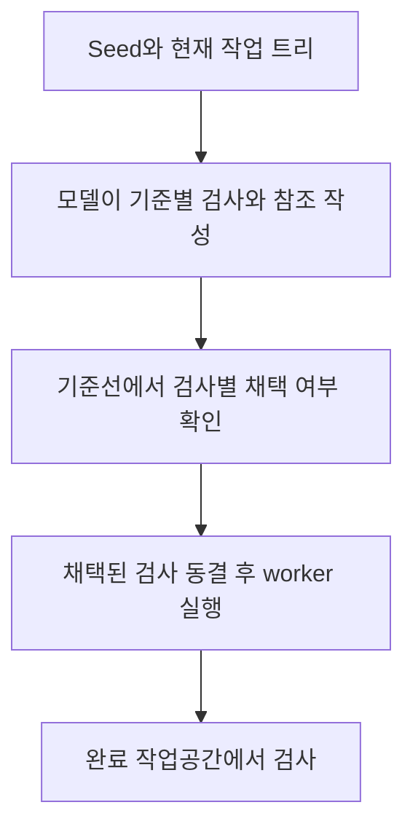
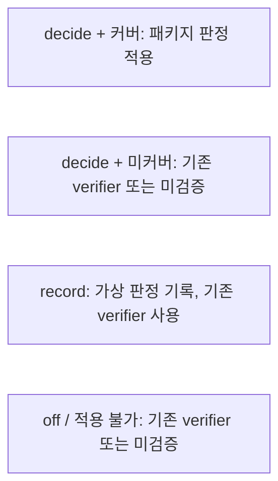

# 검사 패키지: 기준별 증거와 판정

기준: 2026-11-04, Ouroboros 소스 [`722172ef096767583679d04aef5e847458fee6b2`](https://github.com/Q00/ouroboros/tree/722172ef096767583679d04aef5e847458fee6b2). 이 페이지는 고정 버전의 [설정 참조 `boundary`](https://github.com/Q00/ouroboros/blob/722172ef096767583679d04aef5e847458fee6b2/docs/config-reference.md#boundary)와 [CLI 실행 구현](https://github.com/Q00/ouroboros/blob/722172ef096767583679d04aef5e847458fee6b2/src/ouroboros/cli/commands/run.py)을 정리한 것이다. **실제 모델로 검사 패키지를 구성하거나 운영 프로젝트의 판정을 시험하지 않았다.** 릴리스와 연결된 호스트의 버전은 다를 수 있다.

**판본 경계:** 이 세부 설명은 722판의 boundary/Seed/CLI 계약에 한정한다. 정적 비교에서 main [`592c667f`](https://github.com/Q00/ouroboros/tree/592c667f076c3dad7ef68d7844e91480d80135d0) 및 `v0.59.9`는 722판과 boundary binding/tree 구현에 차이가 있고 `run.py`에는 YAML UTF-8 처리 차이도 있다([main binding flow](https://github.com/Q00/ouroboros/blob/592c667f076c3dad7ef68d7844e91480d80135d0/src/ouroboros/boundary/binding_flow.py), [main tree](https://github.com/Q00/ouroboros/blob/592c667f076c3dad7ef68d7844e91480d80135d0/src/ouroboros/boundary/tree.py), [main run CLI](https://github.com/Q00/ouroboros/blob/592c667f076c3dad7ef68d7844e91480d80135d0/src/ouroboros/cli/commands/run.py)). 이 문서의 모든 판정 규칙이 다른 판본에도 그대로 적용된다고 보장하지 않는다. 실제 모델 생성, 설치 호스트의 결과, 재개·운영 프로젝트는 시험하지 않았다. 구체적인 실행 세션 상태와 복구 상세는 [진행 상태](/docs/progress-detail/)와 [복구](/docs/recovery-detail/)를 참조한다.

검사 패키지는 `ooo run`에서 worker가 작업하기 **전** 수용 기준별 실행 가능 검사를 준비·동결하고, 작업 후 적용 가능한 검사로 결과를 확인하는 경계다. 별도의 [정식 평가](/docs/evaluation-evolution-detail/)와 같지 않으며, 검사 하나가 통과해도 요구 전체가 옳다고 보증하지 않는다. 생성에는 모델 호출이 필요해 비용이 발생할 수 있다.

도식이 화면보다 넓으면 도식 안에서 좌우로 스크롤한다.



검사 이후 판정은 모드와 기준별 커버에 따라 다음 중 하나다. 아래 항목은 순서대로 실행하는 단계가 아닌 **서로 다른 경우**다.



## 기본 모드와 설정

| 값 | 관찰과 영향 |
| --- | --- |
| `record` | 기본. 준비·채택·실행하고 가상 판정을 기록하지만 기준·실행 결과를 바꾸거나 worker에 수리 요청을 보내지 않는다. 이 기록은 정식 평가나 evolve의 실제 판정이 아니다. 기존 verifier가 결정한다. |
| `decide` | 채택된 검사가 커버하는 기준에 패키지의 판정을 적용한다. 커버하지 못한 기준은 기존 verifier가 판단하거나 증거 부족으로 미검증이 된다. |
| `on` | 이전 표기로 `decide`와 같다. |
| `off` | 패키지를 끈다. 기존 verifier의 별도 동작까지 끄는 뜻은 아니다. |

다음은 `config.yaml`의 **구성 예시**다. 단순히 파일에 적는 것은 실행이 아니다. 실제 경로·형식과 다른 설정은 [설정 색인](/docs/config-reference-detail/)을 확인한다.

```yaml
boundary:
  check_package: decide
  constructor_timeout_seconds: 600
  check_timeout_seconds: 120
  max_construction_attempts: 2
  base_regression: record
  worker_test_gate: record
```

`constructor_timeout_seconds`는 30–3600초, `check_timeout_seconds`는 5–1800초, `max_construction_attempts`는 1–5다. 기준별 대체 검사 요청 한 번은 구성 시도 예산과 별개다. 새 실행에서 CLI `--check-package`는 `decide`, `--no-check-package`는 `off`를 선택한다. 우선순위는 **CLI 플래그 → `OUROBOROS_CHECK_PACKAGE` → 설정 파일 → 기본 `record`**다. 프로젝트 `.env`로 환경 스위치를 설정할 수 없다. 설정 파일이 없으면 기본 `record`지만 파일을 읽을 수 없고 명시적 플래그·환경값도 없으면 `off`로 처리한다. 실행 시작 후 재개는 시작 당시의 모드와 boundary 설정을 유지한다.

**환경 변수의 값은 정확히 입력한다.** 이 판본은 `decide`, `on`, `record`, `off`만 소문자 그대로 인식한다. 환경 변수가 설정돼 있지만 `true`, `1`, `ON`, 빈 문자열이나 앞뒤 공백처럼 다른 값이면 경고를 기록하고 `off`로 취급한다. 이때 설정 파일의 `decide`나 기본 `record`로 돌아가지 않는다. 예를 들어 `OUROBOROS_CHECK_PACKAGE=true`는 활성화가 아니다. CLI 플래그가 명시됐다면 그 플래그가 우선한다. 작업의 실제 결과에서 모드와 커버를 확인한다. [스위치 구현](https://github.com/Q00/ouroboros/blob/722172ef096767583679d04aef5e847458fee6b2/src/ouroboros/boundary/switch.py), [원본 단위 테스트](https://github.com/Q00/ouroboros/blob/722172ef096767583679d04aef5e847458fee6b2/tests/unit/boundary/test_switch.py). 이는 해당 고정 버전의 규칙이며 다른 버전은 확인해야 한다.

## 무엇을 검사하고 누가 결정하는가

모델이 생성한 Python 검사에는 재현 검사와 보존 검사 등이 있다. 기준 트리에서 재현 검사가 이미 통과하거나 보존 검사가 실패하면 해당 검사만 제외한다. 시작 실패·시간 초과 등으로 기준선 결과가 불확정이어도 그 검사는 제외한다. 공통 사전조건이나 샌드박스 실패 등은 패키지 전체 채택을 막을 수 있다. 미커버 기준에는 worker 시작 전에 대체 검사 구성을 한 번 요청한다. 채택된 검사의 적용 범위가 판정 권한을 결정하며 모든 기준을 자동으로 커버하지 않는다.

Oracle은 프로젝트의 import 가능한 callable이나 명령을 대상으로 사례를 비교할 수 있다. 후보에게 마지막 확인에서만 주는 held-out 사례와 별도로 작성된 참조 구현의 결과를 대조한다. 참조가 Seed에 명시된 사례와 모순되거나 실행되지 않으면 해당 기준을 검증했다고 보지 않는다. 같은 요구를 검사와 참조가 함께 잘못 해석한 경우까지 잡는 장치는 아니다. 후보 코드가 관찰 보고를 직접 쓸 수 있으므로 보고는 **입력에 대한 계산 결과의 증거**이지 지정 함수 자체가 호출됐다는 증명이 아니다. 예외가 발생하지 않았다는 `no_raise` 사례는 후보를 실패시킬 수 있지만 통과만으로 기준을 검증하지 않는다.

`decide` 조정에서도 패키지의 모든 `pass`가 기존 verifier의 거부를 덮어쓰는 것은 아니다. 통과가 작업자가 선언한 바인딩에만 근거한 경우(`declared_binding_pass`)에는 기존 verifier가 해당 시도를 거부했다면 그 거부를 유지하고 `a_prime_corroborates_only`로 기록한다. 반대로 제품 자체 바인딩을 통한 재현 oracle의 held-out 통과가 있는지는 별도로 구분한다. 표시된 tier만으로 이 출처를 판단하지 말고 기준별 판정과 바인딩 출처를 함께 확인한다. 이는 [고정 조정 코드](https://github.com/Q00/ouroboros/blob/722172ef096767583679d04aef5e847458fee6b2/src/ouroboros/boundary/acceptance.py)의 조건이며, 실제 모델·모든 바인딩 조합은 이 문서에서 시험하지 않았다.

패키지가 검증하지 못한 기준은 기존 verifier가 맡는다. 기존 verifier의 `execution.transcript_verifier`도 기본 `record`이므로 거부했을 상황을 기록만 하고 기준이 받아들여질 수 있다. worker가 시도한 기준에 대해 검사 패키지와 기존 verifier 모두 증거를 제공하지 못하면, 적용되는 artifact 검사 등의 실패가 없는 조건에서 미검증으로 받아들여질 수 있고 검증 부족이 보고된다. **`decide` 모드의 실제 조정에서는 시도되지 않은 기준과 패키지 판정이 실패·불확정인 기준을 자동 수용하지 않는다.** 반면 패키지 `record` 모드에서 관찰된 가상 실패·불확정은 그 자체로 실제 결과를 결정하지 않고 기존 verifier 경로가 판단한다. 따라서 성공 상태만 보지 말고 모드와 기준별 커버·판정·미검증을 확인한다. [판정 조건](https://github.com/Q00/ouroboros/blob/722172ef096767583679d04aef5e847458fee6b2/src/ouroboros/boundary/acceptance.py). `execution.transcript_verifier: decide`일 때 기존 verifier의 거부는 실행 실패로 이어진다.

완료 작업공간에서 기존 테스트의 회귀(`base_regression`)와 worker가 새로 추가한 테스트(`worker_test_gate`)도 별도로 확인할 수 있다. 각각 `record`가 기본이며 `decide`·`off`가 있다. **상위 패키지가 `record`면 하위 검사에 `decide`를 써도 결과를 기록만 한다.** 기존 테스트는 기준선 두 번 통과 등의 선택 조건을 만족해야 관찰되므로 미선택·타임아웃·관찰 없음은 성공 증거가 아니다. 패키지 채택 여부에 따라 회귀가 미검증 기준을 실패시키는 조건이 다르다. 자세한 예외는 [원본 설정 참조](https://github.com/Q00/ouroboros/blob/722172ef096767583679d04aef5e847458fee6b2/docs/config-reference.md#boundary)를 확인한다.

## 결과 읽기와 장애 진단

- CLI 결과에서 `record` 여부와 아무것도 결정하지 않았다는 문구, 기준별 커버·미검증 경고를 확인한다. 기록된 `boundary.acceptance.reconciled`는 모드 없이 독립 판정으로 해석하지 않는다.
- `ouroboros_start_execute_seed`의 완료 job 결과는 `check_package`, `check_package_status`, `package_verdict`, `legacy_verdict`, `reconciliation`, `verification_coverage`, `check_package_mode`를 제공한다. 최초 접수의 `pending`은 완료·통과가 아니다. 연결된 서버의 실제 스키마와 결과를 확인한다. [MCP 색인](/docs/mcp-reference-detail/)
- `constructor_session_not_ephemeral:<backend>`는 검사 생성기가 비영속 세션을 보장할 수 없는 런타임이라 모델 호출 전에 패키지를 적용하지 않았음을 뜻한다. 이 판본은 Claude Code의 비영속 모드와 Codex CLI `--ephemeral`을 지원하며, 그 외 런타임에서는 기존 verifier가 기준을 결정한다.
- `repro_passes_on_base`, `preservation_fails_on_base`, `indeterminate_on_base`는 해당 검사가 기준선에서 채택되지 않은 이유다. `reference_contradicts_stated_case`나 `reference_unavailable`은 참조 검증 부족이다. 제외 사유와 최종 커버를 함께 본다.
- OpenCode 플러그인의 외부 자식 세션으로 위임된 실행은 이 경계의 지배를 받지 않으며 결과에 `check_package: not_applied`, `check_package_reason: plugin_dispatch`가 기록된다. 설정값만 보고 적용됐다고 판단하지 않는다.

## 재개와 보안 경계

재개는 시작 때 기록한 계약을 따른다. **`record` 모드의 재개는 검사 패키지를 다시 실행하거나 판정하지 않고 기존 verifier가 결정한다.** 기존 테스트 회귀(`base_regression`)도 재개 시 다시 실행하지 않는다. `decide` 모드에서 같은 프로세스가 채택된 패키지를 보유한 경우 전체 검사와 held-out 사례를 실행할 수 있다. **`decide` 모드에서 다른 프로세스에는 held-out 사례가 저장되지 않으므로 검사 실행 없이 커버 기준이 `held_out_unavailable`로 미결정**되고 나머지는 기존 verifier가 결정한다. `decide` 모드에서 누락·중복·충돌·버전 간격 등 일관되지 않은 journal은 `boundary_record_missing`으로 모든 기준을 미결정 처리하고 검사를 실행하지 않는다. journal 자체를 읽을 수 없어 시작 모드와 경계를 알 수 없으면 재개를 거부한다. 재개 자체의 다른 경계는 [복구](/docs/recovery-detail/)를 참조한다.

검사는 임시 작업공간 복사본과 scratch에서 실행되고, 실행 샌드박스가 정상 적용되면 쓰기·네트워크·환경에 제한이 있다. 샌드박스를 제공할 수 없으면 검사는 미결정이며 실행되지 않는다. **읽기는 제한되지 않는다.** 특히 macOS에서는 다른 프로세스의 인자·환경을 읽을 수 있다는 원본 경고가 있으므로 그 위험이 중요하면 패키지를 끈다. 실행 샌드박스를 비활성화한 경우 격리를 가정하지 않는다. 검사 대상 코드도 실행되므로 신뢰하지 않는 프로젝트를 안전하다고 판단하는 근거로 삼지 않는다. 이 페이지 작성 중 실제 샌드박스 격리나 외부 네트워크 차단은 검증하지 않았다.
