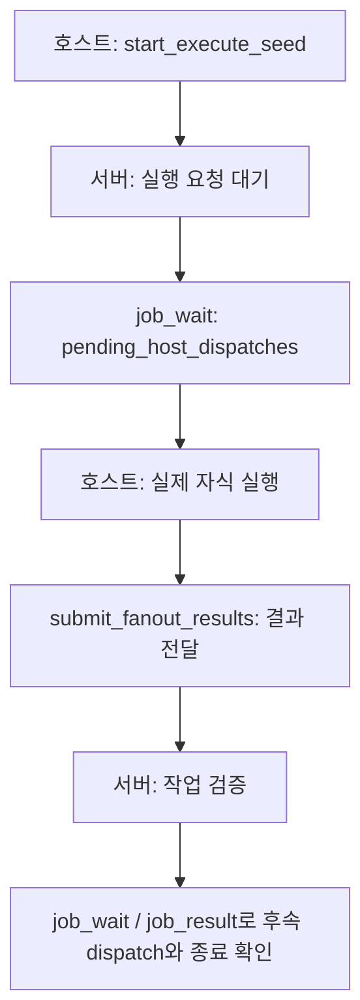

# 호스트 fan-out과 실행 결과 제출

!!! warning "판본과 검증 범위"
    별도 표시가 없으면 이 안내는 제품 소스 [`722172ef`](https://github.com/Q00/ouroboros/tree/722172ef096767583679d04aef5e847458fee6b2)를 기준으로 합니다. 제품 main [`592c667f`](https://github.com/Q00/ouroboros/tree/592c667f076c3dad7ef68d7844e91480d80135d0), 공개 패키지 `0.59.9`, 설치한 호스트와 MCP 서버는 각각 다른 판본일 수 있습니다. 기존 합성·대역 시험은 명시된 조건에 한정되며 실제 모델·외부 서비스·모든 호스트의 실행을 입증하지 않습니다. 현재 설치의 도움말과 [제품 문서](https://github.com/Q00/ouroboros/tree/592c667f076c3dad7ef68d7844e91480d80135d0/docs)를 대조하고 구판 동작이 같다고 가정하지 마세요.


기준: 2026-11-04, Ouroboros source [`722172ef096767583679d04aef5e847458fee6b2`](https://github.com/Q00/ouroboros/tree/722172ef096767583679d04aef5e847458fee6b2). [fan-out 제출 핸들러](https://github.com/Q00/ouroboros/blob/722172ef096767583679d04aef5e847458fee6b2/src/ouroboros/mcp/tools/fanout_handler.py), [상관관계와 결과 검증](https://github.com/Q00/ouroboros/blob/722172ef096767583679d04aef5e847458fee6b2/src/ouroboros/mcp/tools/fanout.py), [host 런타임 안내](https://github.com/Q00/ouroboros/blob/722172ef096767583679d04aef5e847458fee6b2/docs/runtime-guides/host.md)를 기준으로 한다. 연결된 MCP 서버가 실제로 노출하는 도구와 설치 버전을 먼저 확인한다. 이 문서의 JSON은 **MCP 도구 인자**이며 셸 명령이 아니다.

fan-out은 한 요청이 여러 자식 작업을 명시하고, 호스트가 해당 작업의 실제 결과를 상관관계에 맞춰 제출하는 경로다. 자문·조사 fan-out의 종합 결과와 `host` 실행 런타임의 작업자 결과 전달은 같은 제출 도구를 쓰지만 완료 의미가 다르다. 도구의 접수나 자식 출력만으로 전체 작업이 성공했다고 판단하지 않는다.

## 공통 제출 계약

1. 선행 도구가 반환한 fan-out ID, correlation 필드 이름, 등록된 `session_id`와 각 자식 설명을 보존한다. **응답 종류에 따라 필드 위치·이름이 다르다.** 예를 들어 질문 자문은 `meta.question_advisory_fanout_id`와 `meta.question_advisory_result_correlation_key`를 사용하고, lateral 응답은 dispatch record의 `fanout_id`를 사용할 수 있다. `host` 실행의 `job_wait` 항목은 아래에 적은 `fanout_id`와 `result_correlation_key`를 제공한다. 반환된 correlation 값은 자식 정보에서 결과 키를 찾는 필드 경로일 수 있으며, 각 결과의 `key`에는 그 경로에서 **실제로 반환된 값**을 쓴다. 목록 순서나 역할 이름을 보고 임의로 만들어내지 않는다. [질문 자문 등록](https://github.com/Q00/ouroboros/blob/722172ef096767583679d04aef5e847458fee6b2/src/ouroboros/mcp/tools/fanout.py), [메타데이터 작성](https://github.com/Q00/ouroboros/blob/722172ef096767583679d04aef5e847458fee6b2/src/ouroboros/mcp/tools/subagent.py).
2. 호스트가 자식을 실제로 실행한 뒤 각 출력에 `{ "key": "실제 키", "content": "실제 출력" }`을 사용한다. **아예 시작하지 못한** 자식만 정확히 `{ "key": "실제 키", "undispatched": true }`로 표시한다. 실행하지 않은 결과를 지어내거나 `content`와 `undispatched`를 함께 넣지 않는다.
3. `ouroboros_submit_fanout_results`에 원본 `fanout_id`, 실제 `results`, 등록된 경우 **정확한** `session_id`와 `correlation_key`를 전달한다. 스키마에서 후자 두 필드가 선택이라고 해서 이미 등록된 결합을 생략할 수 있는 것은 아니다. 등록에 해당 결합이 없을 때만 생략한다.
4. `status=partial`은 필수 결과가 빠졌거나 제출 결과가 계약 위반으로 제외됐다는 뜻이다. `missing_required_keys`와 `contract_violations`를 함께 확인한다. 서버가 이전 제출을 합산한다고 가정하지 말고, 누락 결과를 확보하거나 실제 미시작을 표시한 뒤 **보유한 모든 lane을 함께 재제출**한다. optional 누락과 undispatched는 완료 보고에 따로 기록될 수 있다. 원본 계약·반환 오류를 확인한다.

잘못된 session 또는 correlation은 `correlation_mismatch`로 거부된다. 알 수 없는 fanout ID, 잘못된 결과 형식, 중복·만료·취소·이미 완료된 전달은 반환 메시지와 실제 작업 상태를 확인한다. 계약과 실행의 최신 상태를 모른다면 새로운 자식 작업을 중복 시작하지 않는다. 실제 결과에는 민감정보가 포함될 수 있으므로 출력·공유 범위도 확인한다. [도구 입력 색인](/docs/mcp-reference-detail/#ouroboros_submit_fanout_results).

## `host` 실행 런타임

호스트가 실제 하위 에이전트를 만들고 결과를 다시 제출할 수 있어야 한다. 설정 예시는 원본 [host 안내](https://github.com/Q00/ouroboros/blob/722172ef096767583679d04aef5e847458fee6b2/docs/runtime-guides/host.md)를 따른다. 서버 환경의 `OUROBOROS_AGENT_RUNTIME=host`보다 `orchestrator.runtime_profile.stages.execute`의 명시 값이 우선할 수 있다. setup은 호스트 설정을 변경할 수 있다. 터미널 `ouroboros run`과 직접 `ouroboros_execute_seed`는 이 런타임의 호스트 루프가 없어 지원되지 않으며, evolve와 Ralph도 이 경로를 지원하지 않는다.

도식이 화면보다 넓으면 도식 안에서 좌우로 스크롤한다.



`ouroboros_start_execute_seed`가 준 **job ID**로 `ouroboros_job_wait`를 호출하고 `meta.pending_host_dispatches`를 확인한다. `ouroboros_job_status`는 대기 요청의 신원을 관찰하지만 실행 호스트의 actionable announcement를 가져가는 경로가 아니다. 각 항목의 `dispatch_id`/`fanout_id`, `session_id`, `result_correlation_key`, `subagents[0].prompt`, `subagents[0].context.working_directory`, `submit_tool`을 확인한다. 호스트는 지시된 작업 디렉터리와 권한 범위 안에서 실제 자식을 실행한다. 제한 시간이나 비용·외부 효과에 대한 사용자 지시는 별도로 따른다.

다음은 반환된 값으로 자리표시자를 교체해야 하는 형식 예시다. `result`는 이 host 실행 계약의 키이며 다른 자문 fan-out에도 같은 키를 임의로 쓰라는 뜻은 아니다.

```json
{
  "fanout_id": "<실제로 받은 fanout ID>",
  "session_id": "<실제로 받은 session ID>",
  "correlation_key": "result",
  "results": [{"key": "result", "content": "<실제 작업자의 결과>"}]
}
```

작업자를 생성하지 못했다면 결과 항목은 `{ "key": "result", "undispatched": true }`다. 이 선언이 유효하게 전달되면 **해당 host 실행 시도는 작업자가 실행되지 않은 종결 실패**로 처리되며, 빈 성공이나 작업 완료가 아니다. 빈 문자열·`null`·빈 객체·배열·실질 출력 없는 성공 표시 등은 이 host 전달에서 거부될 수 있으며, 유효하지 않은 제출은 살아 있는 dispatch를 소비하지 않으므로 원인을 고쳐 같은 ID로 재시도할 수 있다. 이 영수증은 **실행 엔진에 전달됐다는 뜻**이며 서버의 검증이나 작업 완료를 뜻하지 않는다. 이후 같은 job을 `ouroboros_job_wait`로 계속 관찰하고 추가 dispatch가 있으면 처리하며, 종료 후 `ouroboros_job_result`의 실제 결과·검증과 작업 위치를 확인한다. [진행 상태와 ID](/docs/progress-detail/).

자문·조사 fan-out의 완성 결과는 한정된 disposable artifact envelope로 반환될 수 있다. 반환된 `contract_id`로 `ouroboros_fetch_artifact`를 호출해 종합 본문을 읽는다. 본문 읽기는 자식 실행을 다시 수행하지 않는다. [artifact 조회](/docs/artifacts-detail/).

## 중단·재시작과 실패

fan-out correlation 기록은 파일에 보존되지만 살아 있는 host 실행 waiter는 MCP **서버 프로세스에만** 존재한다. 기록 파일이 있다는 사실만으로 서버 재시작 후 대기 작업을 재개하거나 같은 결과를 안전하게 전달할 수 있다고 가정하지 않는다. 시작한 MCP 서버와 job 상태를 확인하고 실제 반환된 오류를 보존한다. host 작업은 이 프로세스에 머물며 detached worker로 옮겨지는 경로가 아니다.

살아 있는 dispatch의 actionable announcement는 한 번 제공된다. 전달이 유실되거나 작업자가 응답하지 않으면 시도 deadline에 만료될 수 있고 재시도는 **새 dispatch ID**로 이뤄진다. 이전 작업자가 여전히 실행 중일 가능성을 고려해 외부 효과의 중복 여부를 판단한다. 절대 deadline 뒤 결과는 전달되지 않으며, 취소·대체·완료된 오래된 제출은 거부될 수 있다. `job_wait` 응답이나 접속 중단만으로 자식이 종료되었다고 판단하지 않는다. 서버가 같은 발행 프로세스의 host-dispatch bridge를 구성하지 않았다면 제출이 실패한다. 저장·재개 전체 제한은 [복구 안내](/docs/recovery-detail/)와 원본 host 안내를 함께 본다.

**검증 범위:** 고정 source와 해당 구현·host 안내를 정적 대조했다. 관련 소스·테스트 경로가 고정 커밋과 동일한 로컬 checkout에서 `tests/unit/mcp/tools/test_fanout_core.py`와 `tests/unit/orchestrator/test_host_dispatch_runtime.py`를 임시 HOME·TMPDIR, telemetry 비활성 조건으로 실행해 83개가 통과했다. 테스트는 가짜 런타임과 임시 데이터를 사용하며 OS 네트워크 격리를 검증하지 않았다. 실제 MCP 호스트가 자식을 실행·전달하거나 실제 모델·외부 효과를 수행한 경로, 모든 호스트의 재시작 복구는 이 문서 작성에서 시험하지 않았다. 관련 도구 정의는 서버별로 확인한다.
