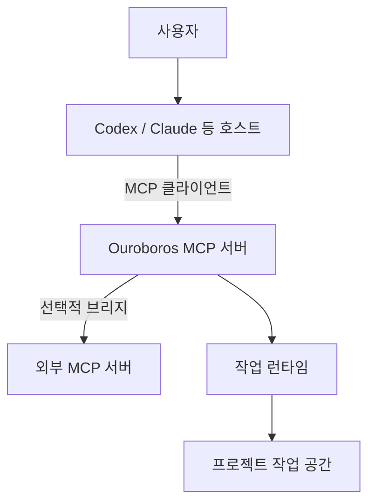

# 호스트와 MCP 연결

기준: 2026-11-04, upstream [722172ef](https://github.com/Q00/ouroboros/tree/722172ef096767583679d04aef5e847458fee6b2). 이 페이지는 소스와 원본 계약을 설명한다. 아래 모든 호스트와 외부 MCP 서버를 연결해 실행한 것은 아니다. 설치된 버전의 스키마와 도움말을 우선 확인한다.

**판본과 확인 범위:** 아래 세부 계약과 합성/stdio 관찰의 기준은 722판이다. 브리지, manager, resources handler 및 server adapter의 인용 파일을 공개 main [`592c667f`](https://github.com/Q00/ouroboros/tree/592c667f076c3dad7ef68d7844e91480d80135d0) 및 release `v0.59.9`와 정적으로 대조했을 때 해당 파일에는 차이가 보이지 않았다. 이는 선택한 파일만의 비교이며 host별 setup, SDK·환경 상속, 전체 MCP 조립·인증·파일 권한의 동등성을 뜻하지 않는다. 실제 사용자의 호스트, 외부 MCP 서버 및 운영 데이터는 시험하지 않았다. 공개 재현 자료가 없는 내부 synthetic/SDK 관찰은 각 문단에서 범위를 한정하며, 세션의 진행·복구 세부는 [진행 상태](/docs/progress-detail/)와 [복구](/docs/recovery-detail/)를 함께 확인한다.

## 세 연결을 먼저 구분

도식이 화면보다 넓으면 도식 안에서 좌우로 스크롤한다.



1. **호스트 → Ouroboros**: 호스트가 Ouroboros의 MCP 도구를 호출한다. 플러그인과 독립 CLI는 별도 설치 경로다. [설치와 첫 실행](/docs/first-run-detail/)과 [MCP 도구 색인](/docs/mcp-reference-detail/)을 참고한다.
2. **Ouroboros → 외부 MCP 서버**: 외부 도구를 작업 중 사용하려면 별도의 클라이언트 구성 및 해당 실행 경로의 브리지가 필요하다. 호스트에서 보이는 도구가 자식 런타임에도 자동으로 전부 보인다고 가정하지 않는다.
3. **Ouroboros → 작업 런타임**: 런타임이 모델과 작업 공간에서 실행한다. 인터뷰를 수행하는 LLM 백엔드와 작업 런타임 설정을 구분하고 각 호스트의 로그인·모델·도구 권한을 확인한다.

### Codex에서 Ouroboros 도구를 찾으려면

먼저 실행 사용자와 `HOME`·`CODEX_HOME`을 확인하고 [호스트 설정과 복구](/docs/setup-host-detail/)의 Codex 절차로 설치된 버전의 도움말과 정적 `ouroboros codex doctor` 결과를 확인한다. 등록이 필요하다면 같은 문서의 MCP 모드별 변경 범위를 확인한 뒤 설정한다. `setup`은 설정을 변경하므로 단순 조회가 아니다. 필요할 때만 설정된 명령을 검토한 후 `ouroboros codex doctor --live-mcp`로 **stdio** 서버의 초기화와 도구 목록을 점검한다. 이 검사는 설정된 서버 프로세스를 실제로 실행하며 URL 전송·모델 인증·작업 완료를 검증하지 않는다.

호스트에서 Ouroboros 도구가 보이는 것과 Ouroboros가 **외부 MCP 서버의 도구를 작업 런타임에 전달하는 것**은 별개다. 후자가 필요하면 아래 외부 MCP 절차에서 사용할 실행 경로와 필수 도구를 따로 확인한다. 상세 명령·설정 파일과 복구는 [호스트 설정](/docs/setup-host-detail/), 도구의 이름과 입력은 [MCP 도구 색인](/docs/mcp-reference-detail/), 실패 시 순서는 [진단](/docs/diagnostics-detail/)을 따른다. 이 안내는 실제 Codex 호스트 연결이나 인증을 새로 시험한 결과가 아니다.

## 런타임 선택과 전이

`orchestrator.runtime_backend`와 `OUROBOROS_AGENT_RUNTIME`, 각 진입점의 `--runtime`은 관련 실행 경로에서 런타임 선택에 쓰인다. 실제 선택 우선순위와 허용값은 사용하는 진입점과 판본의 도움말을 확인한다. 예를 들어 다음은 **실행을 시작하는 명령 형식**이지 비용 없는 연결 검사 명령이 아니다.

```bash
ouroboros run workflow --runtime codex /path/to/seed.yaml
```

`ooo auto --runtime`의 인터뷰·Seed 생성·검토는 인프로세스 작성 핸들러가 선택한 백엔드를 호출하고, RUN 인계에서 실행 런타임을 사용한다. 첫 질문이 느리다고 이미 하위 작업 실행이 시작됐다고 볼 수 없다. 저장된 세션을 다른 런타임 값으로 재개하려 하면 런타임 불일치가 거부될 수 있다. [auto 단계별 계약](https://github.com/Q00/ouroboros/blob/722172ef096767583679d04aef5e847458fee6b2/docs/auto-runtime-semantics.md).

모든 런타임에 같은 도구 강제·승인·재개 능력이 있는 것은 아니다. 원본 [런타임 기능표](https://github.com/Q00/ouroboros/blob/722172ef096767583679d04aef5e847458fee6b2/docs/runtime-capability-matrix.md)는 `native`(직접 지원), `translated`(일부 변환), `ignored`(적용 안 됨)로 실행 인자 처리를 구분한다. 예를 들어 Codex 등의 일부 어댑터에서 비어 있지 않은 도구 허용 목록은 프롬프트 안내로 변환될 수 있으므로 운영체제 차단이나 호스트 권한 경계로 취급하면 안 된다. 런타임 표의 일부 행은 최신 백엔드를 빠뜨릴 수 있으며, 같은 표의 `dry-run` 행은 [CLI 참조의 기본 orchestrator 제한](/docs/first-run-detail/)에 배치된다. 특정 실행 전 해당 [런타임 안내](https://github.com/Q00/ouroboros/tree/722172ef096767583679d04aef5e847458fee6b2/docs/runtime-guides), 실제 바이너리의 기능 및 격리 설정을 확인한다.

## 외부 MCP 도구를 연결할 때

독립 CLI의 `ouroboros run workflow`는 `--mcp-config`로 외부 MCP 서버 구성 파일을 명시적으로 받는다. 파일의 `command`와 `args`는 프로세스 실행으로 이어질 수 있으므로 작성자와 내용을 먼저 검토하고, 필요한 경로·권한만 가진 서버를 사용한다. [CLI 구현](https://github.com/Q00/ouroboros/blob/722172ef096767583679d04aef5e847458fee6b2/src/ouroboros/cli/commands/run.py)과 [구성 예시](https://github.com/Q00/ouroboros/blob/722172ef096767583679d04aef5e847458fee6b2/docs/examples/mcp-config.yaml)를 참고한다. 구성 파일이 있다고 연결·도구 노출·권한 제한이 보장되는 것은 아니다. 서버별 연결 결과와 실제 도구 목록을 확인하고, 오류나 미연결을 성공으로 간주하지 않는다. 비밀값은 문서·로그·커밋에 넣지 않는다.

**필수 도구의 연결 실패가 실행을 자동 중단한다고 가정하지 않는다.** 고정 소스의 독립 CLI 경로는 구성 로드 오류 또는 모든 서버 연결 실패 시 오류·경고를 출력하고 외부 MCP 관리자 없이 orchestrator 초기화를 계속한다. 일부 서버만 연결된 경우에도 연결된 부분으로 계속한다. 따라서 특정 외부 도구가 필수라면 실행 전에 별도 환경에서 구성·서버별 연결·도구 목록을 확인하고, 누락 시 호출자가 실행을 시작하지 않는 절차가 필요하다. 이 문서는 그 사전 검사를 수행하는 전용 CLI 명령이 있다고 주장하지 않는다. `--mcp-config`와 `--dry-run`을 결합하는 것 역시 안전한 사전 검사법이 아니다. [첫 실행의 dry-run 경계](/docs/first-run-detail/)를 확인한다. 이는 소스 분기 확인이며 실제 외부 서버 연결 실패 뒤 모델 실행을 시험한 것은 아니다.

별도의 MCP 서버 브리지 자동 탐색은 위 CLI의 **명시적 `--mcp-config`**와 다른 경로다. 이 커밋의 [`discover_config`](https://github.com/Q00/ouroboros/blob/722172ef096767583679d04aef5e847458fee6b2/src/ouroboros/mcp/bridge/config.py)는 다음 두 위치만 순서대로 확인한다.

1. 존재하는 `OUROBOROS_MCP_CONFIG` 환경 변수 경로.
2. 존재하는 `~/.ouroboros/mcp_servers.yaml`.

프로젝트의 `./.ouroboros/mcp_servers.yaml`은 **자동 탐색하지 않는다**. 복제한 저장소가 임의 서버 명령을 몰래 실행시키는 것을 막기 위한 경계다. 같은 커밋의 [브리지 안내](https://github.com/Q00/ouroboros/blob/722172ef096767583679d04aef5e847458fee6b2/docs/guides/mcp-bridge.md)는 세 번째로 프로젝트 경로를 열거하지만, 현재 구현과 [회귀 테스트](https://github.com/Q00/ouroboros/blob/722172ef096767583679d04aef5e847458fee6b2/tests/unit/mcp/bridge/test_config.py)가 이를 부정한다. 프로젝트 파일을 사용해야 한다면 내용을 신뢰할 수 있는지 직접 확인하고 사용 중인 경로에서 명시적으로 지정한다. 이 문서의 단위 검사는 자동 탐색 함수만 확인했으며 실제 외부 서버 실행은 하지 않았다.

브리지 연결은 서버별로 성공·실패할 수 있다. `MCPBridge.is_connected`는 연결 절차 상태이지 **모든 외부 서버 연결에 성공했다는 뜻이 아니다**. 결과별 오류를 읽는다. 격리된 로컬 stdio 덧셈 서버를 연결·호출한 별도 시험에서는 정상 결과를 확인했고, 존재하지 않는 실행 파일은 서버별 오류를 반환하면서도 이 플래그가 `true`가 되는 것을 재현했다. 이는 외부 서버·인증 검증은 아니다. 서버 구성 변경을 런타임 중 자동 반영한다고 가정하지 말고 브리지의 동적 추가 제약과 현재 호스트의 재연결 방식부터 확인한다. [브리지 구현](https://github.com/Q00/ouroboros/blob/722172ef096767583679d04aef5e847458fee6b2/src/ouroboros/mcp/bridge/bridge.py), [원본 안내의 제한](https://github.com/Q00/ouroboros/blob/722172ef096767583679d04aef5e847458fee6b2/docs/guides/mcp-bridge.md).

**브리지 종료 결과 확인:** 고정 `MCPBridge.disconnect()`는 내부 `manager.disconnect_all()`의 서버별 `Result` 맵을 반환하거나 검사하지 않은 채 호출이 정상 반환되면 `is_connected`를 `false`로 바꾼다. 이 상태에서 브리지의 `disconnect()`를 다시 호출해도 내부 정리를 다시 시도하지 않는다. 따라서 브리지 플래그나 종료 함수의 반환만으로 각 서버가 성공적으로 종료됐다고 판단하지 않는다. 필요한 경우 종료 전에 관리자의 연결 상태를 확인하고, 정리 오류와 자식 프로세스를 별도로 확인한다. 이는 [고정 브리지](https://github.com/Q00/ouroboros/blob/722172ef096767583679d04aef5e847458fee6b2/src/ouroboros/mcp/bridge/bridge.py)와 [관리자](https://github.com/Q00/ouroboros/blob/722172ef096767583679d04aef5e847458fee6b2/src/ouroboros/mcp/client/manager.py)의 소스 대조다. 합성 오류 `Result`를 반환하는 가짜 관리자 시험에서 브리지가 `None`을 반환하고 플래그를 내리며 두 번째 호출을 생략했다. 이는 실제 서버나 자원 누수를 검증하지 않았으며, `disconnect_all()` 자체가 예외를 던지는 경로와는 구분한다. 한 합성 관리자 사례의 관찰이며 공개 재현 코드는 제공하지 않는다.

## 이름 충돌과 호출 실패의 범위

서버 연결이 성공하더라도 도구·리소스 발견이 성공했다는 뜻은 아니다. 고정 `MCPClientManager.connect`는 연결 성공 뒤 `list_tools`와 `list_resources`를 각각 조회하는데, 이들이 `Result.err`를 반환하면 경고를 기록하고 해당 목록을 빈 값으로 취급하면서 연결 세대가 중간에 바뀌지 않았다면 해당 연결 시도를 `CONNECTED`로 기록한다. 이후 health check 등에 따라 상태는 바뀔 수 있다. 따라서 빈 목록은 서버가 실제로 도구를 제공하지 않는 경우와 발견 오류를 구분하지 못할 수 있다. 서버별 로그와 연결·발견 결과를 함께 확인하고 필수 도구가 보이지 않으면 실행을 보류한다. 이는 [고정 manager 구현](https://github.com/Q00/ouroboros/blob/722172ef096767583679d04aef5e847458fee6b2/src/ouroboros/mcp/client/manager.py)의 `Result.err` 경로를 정적으로 대조한 것이며, 실제 manager에 mock adapter를 주입한 합성 시험에서 각 목록이 따로 `Result.err`인 사례의 빈 목록·`CONNECTED`를 확인했다. 별도로 예외가 던져진 한 사례는 전파 직후 `CONNECTING`이었으나 다른 예외·후속 health check·실제 서버 장애로 일반화하지 않는다. 이는 공개 재현 자료가 없는 manager 합성 사례의 관찰이다.

고정 소스의 `MCPToolProvider`가 외부 도구를 모을 때 `tool_prefix`는 **모든 외부 도구 이름 앞에 공통으로** 붙는다. 서버별 고유 네임스페이스를 자동으로 만들지는 않는다. 표시 이름이 내장 도구와 충돌하면 외부 도구가 가려지고, 서로 다른 서버가 같은 이름을 제공하면 먼저 발견된 서버의 도구만 남으며 나머지는 충돌로 기록된다. 따라서 서버 연결과 도구 이름의 존재뿐 아니라 선택된 서버 출처와 충돌 경고를 확인하고, 모호한 이름을 별도 구성·서버 설계에서 구분한다. `MCPClientManager.find_tool_server`로 이름만 찾아 호출하는 별도 경로도 연결된 서버 중 첫 일치를 선택한다. [도구 카탈로그와 충돌 처리](https://github.com/Q00/ouroboros/blob/722172ef096767583679d04aef5e847458fee6b2/src/ouroboros/orchestrator/mcp_tools.py), [서버 탐색](https://github.com/Q00/ouroboros/blob/722172ef096767583679d04aef5e847458fee6b2/src/ouroboros/mcp/client/manager.py).

호출 경로에 따라 실패 처리도 다르다. 이 판본의 provider는 호출에서 `MCPConnectionError` 또는 timeout 예외가 **던져지면** 제한된 재시도를 적용한다. 반면 manager의 `call_tool`은 보통 오류를 `Result.err`로 반환하며, 연결 복구를 시도하더라도 실패한 도구 호출의 그 결과를 반환한다. 반환된 오류를 예외 재시도와 동일시하지 않는다. 시간 초과나 연결 실패는 외부 서버가 쓰기를 수행하지 않았다는 증거가 아니므로, 쓰기 도구는 대상 시스템의 멱등성·결과 조회 계약을 확인하고 결과가 불명인 경우 재호출 전 대사한다. 이 구분은 소스와 대역 테스트를 읽은 것이며 실제 외부 쓰기·장애 복구를 검증하지 않았다.

외부 도구 응답을 받았다는 것과 그 도구가 작업을 성공했다는 것은 별개다. 고정 `MCPToolProvider`는 manager 호출이 `Result.ok`를 반환하면 그 안의 `MCPToolResult.is_error`가 참이어도 결과 객체를 `Result.ok`로 전달한다. 호출자는 바깥 `Result`의 성공뿐 아니라 내부 `is_error`와 내용을 확인해야 한다. 이 경로에 대한 [구현](https://github.com/Q00/ouroboros/blob/722172ef096767583679d04aef5e847458fee6b2/src/ouroboros/orchestrator/mcp_tools.py)의 정적 대조이며, 모든 런타임이나 서버가 동일하게 처리된다는 뜻은 아니다. 실제 provider와 가짜 manager를 쓴 합성 한 사례에서 바깥 ok와 내부 is_error=true 및 내용·메타데이터 보존을 확인했다. 별도 합성 로컬 stdio 서버의 오류 응답도 실제 SDK adapter·manager·provider를 거쳐 바깥 ok/내부 오류로 관찰했다. 이 서버의 SDK는 클라이언트 응답에서 예외 내용을 일반 오류 문구로 바꿨으나 합성 예외 traceback은 서버 stderr에 남았다. 이것은 비밀이나 민감정보가 모든 로그에서 은닉된다는 보장이 아니다. 실제 외부 서비스나 후속 런타임 처리는 시험하지 않았다.

고정 `OrchestratorRunner`의 시작·재개 경로는 MCP manager가 구성된 경우 `MCPToolProvider`로 외부 도구 발견을 시도하고 정책을 적용한 이름과 도구 카탈로그를 실행 경로에 전달한다. manager가 없거나 발견 중 예외가 발생하면 기존 기본 카탈로그에 정책을 적용하는 경로로 돌아가며, 발견 결과가 비어도 기본 카탈로그를 사용한다. 해당 두 경로에서 반환된 `mcp_provider` 변수 자체는 이후 참조되지 않는다. 따라서 위의 provider 직접 호출 시험만으로 orchestrator가 외부 도구 오류를 어떻게 전달하거나 판정하는지 결론 내릴 수 없다. 선택한 런타임·호스트의 실제 도구 연결과 오류 후속 처리는 별도 확인한다. 이는 [고정 runner 구현](https://github.com/Q00/ouroboros/blob/722172ef096767583679d04aef5e847458fee6b2/src/ouroboros/orchestrator/runner.py)의 정적 대조이며 실제 모델·호스트 실행은 시험하지 않았다.

## 구성의 변수 치환과 로컬 HTTP 경계

외부 MCP 구성의 서버 `env`에 있는 `${VAR_NAME}`은 현재 프로세스 환경변수로 치환하며 변수가 없으면 해당 서버 구성 파싱이 실패한다. 다만 환경변수가 존재하지만 빈 문자열인 경우 파싱은 성공하고 빈 값이 전달될 수 있으므로, 파싱 성공을 자격증명이 준비됐다는 증거로 보지 않는다. 고정 소스와 차이가 없는 파서에 합성 환경변수를 빈 값으로 둔 직접 시험은 성공했고, 같은 변수를 제거하면 오류를 반환했다. 이 시험은 파서에 한정되며 서버 연결·실제 인증·OS 네트워크 격리를 확인하지 않았다. **같은 판본의 `headers`, `args`, `url`에는 이 파서의 치환이 적용되지 않는다.** 치환 helper는 env 내부 중첩 mapping과 목록의 문자열은 처리하지만 목록 안 mapping까지 재귀 처리하지 않는다. 이는 helper의 구조적 동작이며 중첩 값이 실제 프로세스 환경변수로 지원된다는 뜻은 아니다. 누락된 변수 오류에는 변수명과 원본 서버명이 포함될 수 있으므로 공유 전 확인한다. 따라서 원본 예제의 `Authorization: "Bearer ${API_TOKEN}"`을 그대로 쓰면 토큰이 채워지지 않고 해당 문자가 헤더 값으로 남는다. [구성 파서](https://github.com/Q00/ouroboros/blob/722172ef096767583679d04aef5e847458fee6b2/src/ouroboros/orchestrator/mcp_config.py)에서 `env`만 치환하고 `headers`는 그대로 전달하는 것을 확인했다. 토큰을 YAML에 직접 기입해 해결하지 말고 사용하는 호스트·전송 경로에서 지원하는 안전한 인증 방법을 확인한다. 이 점검은 더미 값으로 파서만 호출했으며 인증 서버로 요청을 전송하지 않았다.

stdio 서버의 환경을 빈 `env`로 설정해도 하위 프로세스가 완전히 빈 환경이나 별도 파일 접근 권한을 갖는 것은 아니다. 고정 Ouroboros factory는 구성된 `env`를 MCP SDK에 전달한다. 이번에 설치해 정적으로 확인한 **MCP SDK 2.3.0의 POSIX 경로**는 `HOME`, `LOGNAME`, `PATH`, `SHELL`, `TERM`, `USER` 중 현재 환경에 존재하는 기본값을 물려받고 지정 `env`를 덮어쓴다. SDK·OS별 동작은 확인해야 하며, 신뢰할 수 있는 서버를 사용하고 필요한 경우 별도 계정·HOME 및 OS 격리를 적용한다. 합성 stdio 서버 두 연결에서 빈 env의 부모 HOME·PATH 상속과 비기본 변수 미상속, 명시 HOME override를 확인했다. 실제 서버의 파일 접근, 모든 기본 변수와 다른 SDK·OS·호스트는 시험하지 않았다. 이 관찰은 설치한 SDK 2.3.0의 한 POSIX 경로에 한정되며 공개 재현 조건은 제공하지 않는다.

이 판본의 HTTP·SSE·streamable HTTP 원격 전송은 기본적으로 `localhost`, 루프백·사설·링크 로컬 주소 및 해당 주소로 해석된 호스트를 설정 검증에서 거부한다. 그래서 [원본 브리지 예제](https://github.com/Q00/ouroboros/blob/722172ef096767583679d04aef5e847458fee6b2/docs/guides/mcp-bridge.md)의 `http://localhost:3000/mcp`는 기본 상태에서 그대로 통과하지 않는다. 코드는 `OUROBOROS_ALLOW_LOCAL_TRANSPORT=1`을 로컬 개발용 예외로 제공하지만 이 값은 로컬 주소만 하나 허용하는 설정이 아니라 관련 주소 범위 차단을 완화하므로 신뢰할 수 있는 격리 개발 환경에서만 명시적으로 사용한다. 표준 검증은 DNS 조회가 실패하면 이를 결정적 차단이 아니라 미확정으로 취급한다. URL 검증 하나가 DNS 변경·리다이렉트·실제 네트워크 격리까지 보장한다고 가정하지 않는다. [전송 URL 검증 코드](https://github.com/Q00/ouroboros/blob/722172ef096767583679d04aef5e847458fee6b2/src/ouroboros/mcp/types.py).

2026-11-04 고정 source의 `parse_server_config`를 빈 자격 증명 대신 더미 환경값으로 직접 호출해 `env` 치환, 헤더 리터럴 보존, 기본 localhost 거부, 예외 설정 시 구성 검증 통과를 확인했다. 별도 합성 파서 시험에서는 args·headers·URL의 placeholder와 목록 안 mapping의 placeholder가 그대로 남았고 중첩 mapping과 목록 문자열은 치환됐다. 이 실험은 네트워크 연결·서버 인증이나 도구 권한을 검증하지 않았다. URL·헤더 설정이나 런타임 구현은 버전별로 달라질 수 있다.

## MCP 리소스로 Seed·세션·이벤트 읽기

도구 호출과 별도로, 고정 소스의 기본 MCP 서버는 읽기용 리소스 핸들러 세 개를 등록한다. 클라이언트의 `resources/list`는 다음 네 URI를 노출하며 `resources/read`로 읽는다. 실제 연결된 서버에서 목록을 먼저 확인한다. 이 표는 모든 호스트가 동일한 리소스를 제공한다는 보장이 아니다. [서버 조립](https://github.com/Q00/ouroboros/blob/722172ef096767583679d04aef5e847458fee6b2/src/ouroboros/mcp/server/adapter.py), [리소스 핸들러](https://github.com/Q00/ouroboros/blob/722172ef096767583679d04aef5e847458fee6b2/src/ouroboros/mcp/resources/handlers.py).

| URI | 고정 구현의 읽기 결과 |
| --- | --- |
| `ouroboros://seeds` | 기본 Seed 디렉터리의 유효한 YAML·YML·JSON 파일에서 ID·목표 등의 목록과 개수. 잘못된 파일은 건너뛴다. |
| `ouroboros://sessions` | 이벤트 저장소에서 재구성 가능한 세션 목록과 개수. 재구성 실패는 목록에서 빠질 수 있다. |
| `ouroboros://sessions/current` | `running` 또는 `paused` 세션 중 최근 활동 기준 하나, 없으면 `session: null`. 이것만으로 프로세스가 살아 있다고 증명하지 못한다. |
| `ouroboros://events` | 최근 이벤트 최대 100개와 개수. 전체 이력이 아니다. |

핸들러는 각각 `ouroboros://seeds/{seed_id}`, `ouroboros://sessions/{session_id}`, `ouroboros://events/{session_id}`도 처리한다. 이 개별 URI는 위 `resources/list`의 네 정적 정의에 포함되지 않으므로, 목록에서 보이지 않는다고 해당 고정 구현의 경로가 없는 것은 아니다. Seed ID는 파일명만이 아니라 읽은 Seed의 metadata ID와 일치해야 한다. 고정 핸들러는 Seed 디렉터리의 `*.yaml`·`*.yml`·`*.json`을 찾은 뒤 경로를 `resolve()`하므로, 해당 패턴의 심볼릭 링크가 디렉터리 밖의 유효한 Seed 파일을 가리키면 서버 프로세스의 읽기 권한으로 이를 목록화하고 metadata ID로 내용을 반환할 수 있다. Seed 디렉터리와 링크의 작성 권한을 신뢰 경계로 취급하고 노출할 파일만 배치한다. 격리된 합성 디렉터리의 직접 핸들러 및 실제 고정 stdio 서버·MCP SDK 시험에서 외부 합성 YAML 대상 하나를 목록·조회했다. 실제 사용자 파일·다른 파일 종류·경합·인증은 시험하지 않았다. [고정 핸들러](https://github.com/Q00/ouroboros/blob/722172ef096767583679d04aef5e847458fee6b2/src/ouroboros/mcp/resources/handlers.py). 직접 핸들러 및 stdio 결과는 한 합성 symlink 사례이며 공개 재현 자료는 없다. 세션별 이벤트는 최대 100개이며, 해당 이벤트가 없으면 이 구현은 빈 목록 대신 찾지 못한 오류를 반환한다. 이 동작과 오류 표현은 클라이언트와 버전에 따라 달라질 수 있다. 서버가 기록한 ID를 사용하고, 실행 생존 여부와 더 넓은 조회는 [이벤트 조회](/docs/query-projections-detail/)와 [진행상태](/docs/progress-detail/)를 함께 확인한다.

고정 stdio 서버는 `resources/templates/list`에서도 `ouroboros://seeds/{resource_id}`, `ouroboros://sessions/{resource_id}`, `ouroboros://events/{resource_id}` 세 템플릿을 노출한다. 예를 들어 MCP Python SDK의 `await session.list_resource_templates()` 결과의 `resource_templates`에서 확인하고, 서버가 반환한 실제 ID를 넣어 `read_resource`로 조회할 수 있다. 정적 `resources/list`와 템플릿 목록은 서로 다른 목록이며, 템플릿이 보인다고 해당 ID가 존재하거나 접근이 허용된다는 뜻은 아니다. 고정 소스는 경로가 없는 단일 세그먼트 기본 URI에 템플릿을 등록하며 `sessions/current`에는 별도 템플릿을 만들지 않는다. 이는 격리된 빈 HOME의 고정 stdio 서버와 MCP SDK에서 목록 세 개를 확인한 사례이며 다른 서버·SDK·인증 환경은 미검증이다. [고정 서버 구현](https://github.com/Q00/ouroboros/blob/722172ef096767583679d04aef5e847458fee6b2/src/ouroboros/mcp/server/adapter.py). 이 합성 서버 관찰의 공개 재현 자료는 없다.

**정보 경계:** Seed 상세는 Seed 내용을 반환하고 세션은 재구성된 상태를 반환할 수 있으므로 접근 권한과 출력 보관을 제한한다. 이벤트의 `data`에는 키 이름과 텍스트 패턴 기반 정제가 적용되지만 모든 개인정보·비밀을 제거한다는 보장은 아니다. 리소스 읽기 결과를 외부에 공유하기 전에 별도로 검토한다. 이 리소스들이 보이는 것만으로 모든 정보가 안전하게 정제됐다고 가정하지 않는다.

2026-11-04 고정 소스의 실제 stdio 서버를 빈 임시 HOME에서 시작하고 MCP Python SDK로 `initialize`·`list_resources`·읽기를 실행한 합성 시험에서 위 네 URI, 빈 목록 세 개와 `session: null`, 문서의 합성 Seed 하나의 목록·metadata ID 상세 읽기, 존재하지 않는 각 ID의 `MCPError`를 확인했다. 이 시험은 실제 사용자 데이터, 비어 있지 않은 세션·이벤트 이력, 인증 또는 다른 호스트를 검증하지 않았다. 임시 HOME과 Linux user/network namespace를 사용했지만 Unix socket·상속 FD까지 모든 통신 차단을 증명하지 않는다. 이는 공개 재현 자료가 없는 과거 합성 시험 결과다.


별도 비어 있지 않은 합성 시험에서는 임시 EventStore에 실행 중 세션 하나와 관찰 이벤트를 기록한 뒤 실제 stdio 서버와 SDK로 목록·현재 세션·ID별 세션·최근 및 ID별 이벤트를 읽었다. 세션 목록에는 합성 목표 문장이 그대로 포함됐다. 이벤트 저장소에서 합성 `password`와 중첩 `api_key` 값이 원문으로 존재함을 먼저 확인한 후, 리소스 결과에는 두 값이 `[redacted]`로 표시되고 일반 `note`는 유지되는 것을 확인했다. 이는 해당 키와 한 이벤트의 관찰이며 모든 민감 정보·중첩 형태·저장 경로의 정제를 증명하지 않는다. 실제 사용자 이력·인증·다른 호스트는 시험하지 않았다. 이 한 합성 이벤트 사례의 공개 재현 자료는 없다.

## 실무 점검 순서

1. 사용할 호스트·버전·프로젝트 경로와 런타임 인증 상태를 확인한다. 토큰 값은 공유하지 않는다.
2. 실제 필요한 외부 서버의 명령·대상·권한·자격 증명 전달 경계를 검토한다. 자동 발견과 명시적 구성의 차이를 확인한다.
3. 해당 경로에서 서버별 연결과 제공 도구 목록을 확인한다. 유사한 이름의 호스트 도구와 외부 도구를 혼동하지 않는다.
4. 읽기 전용의 작은 작업으로 도구가 실제 필요한 경로에 전달되는지 확인한다. 출력·오류·버전과 미검증을 기록한다. 쓰기·게시·삭제는 별도 작업 권한과 대상 확인이 필요하다.
5. 연결이 끊기거나 버전이 달라지면 [운영과 진단](/docs/operations-detail/) 및 [복구](/docs/recovery-detail/)를 참조하고, 새 실행을 무작정 시작하지 않는다.
