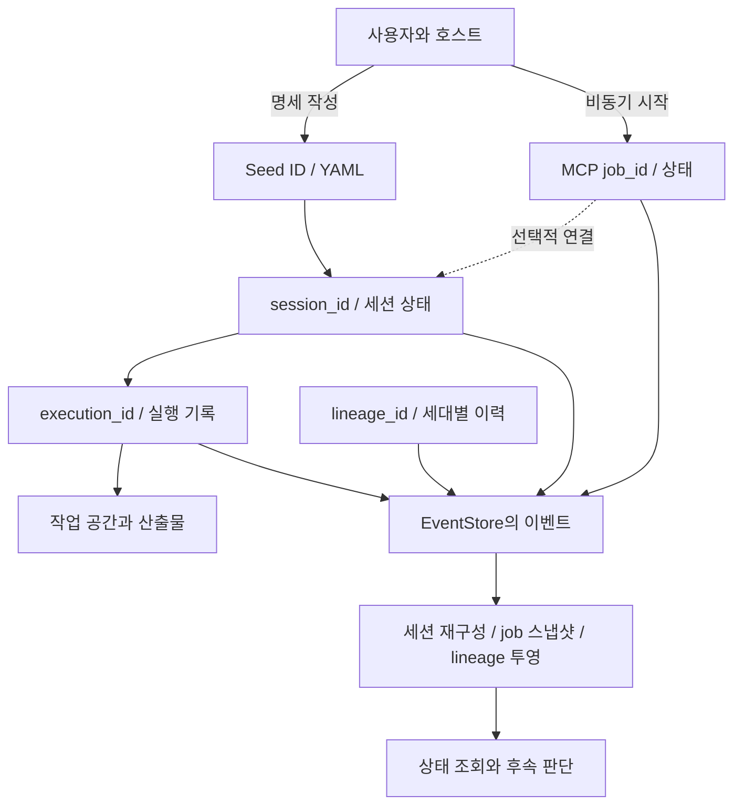

# 생명주기, 저장과 복구 경계

> **판본과 검증 범위:** 이 안내는 2026-11-04에 조사한 Ouroboros 고정 소스 [`722172ef096767583679d04aef5e847458fee6b2`](https://github.com/Q00/ouroboros/tree/722172ef096767583679d04aef5e847458fee6b2)를 기준으로 한다. 2026-11-06에 확인한 upstream `main` (`592c667f076c3dad7ef68d7844e91480d80135d0`) 및 2026-11-07에 기록된 공개 릴리스 `v0.59.9`와 이 본문의 동등성은 확인하지 않았다. 설치된 호스트 플러그인·MCP 서버의 실제 동작도 미검증이다. 설치판의 도움말·설정·도구 스키마를 먼저 확인하고, 아래 시험 사례를 운영 성공이나 현재판 보장으로 일반화하지 않는다.

기준: 2026-11-04, [Q00/ouroboros `722172ef`](https://github.com/Q00/ouroboros/tree/722172ef096767583679d04aef5e847458fee6b2). 아래는 고정 소스와 대역 테스트를 읽어 정리한 구조다. 설치된 패키지·호스트와 차이가 있을 수 있고, 기록 재생이 프로세스 생존이나 외부 효과의 정확한 복구를 보장하지 않는다. 사용자가 실제로 받은 ID와 [진행 확인](/docs/progress-detail/), [복구 안내](/docs/recovery-detail/)를 함께 사용한다.

## 어떤 ID를 보존하나

| 대상 | 역할 | 혼동하면 생기는 문제 |
| --- | --- | --- |
| Seed ID / 파일 | 목표·제약·수용 기준을 담은 명세의 식별자 | Seed가 있다는 것만으로 실행이나 평가가 시작된 것은 아니다. 파일·수정 이력과 해당 실행의 연결을 확인한다. |
| `job_id` | 비동기 MCP 작업의 접수·상태·결과 조회 단위 | job 완료만으로 하위 실행·연쇄 평가의 최종 수용을 추정하지 않는다. 결과에 연결된 ID나 후속 job을 확인한다. |
| `session_id` | 오케스트레이터 세션의 진행·중단·복원 식별자 | job ID나 lineage ID 대신 입력하지 않는다. 같은 ID의 저장된 기록과 실행 소유자를 먼저 확인한다. |
| `execution_id` | 실행 스트림 및 상태 조회에 연결되는 식별자 | session과 값이 같다고 가정하지 않는다. 응답에서 실제로 제공된 연결을 사용한다. |
| `lineage_id` / generation | 진화 과정 전체와 그 안의 세대·판정 이력 | 세대 반복의 종료 이유가 원래 실행 세션의 수용 판정과 동일하다고 가정하지 않는다. |

MCP `JobLinks`에는 `session_id`, `execution_id`, `lineage_id`가 각각 선택적으로 저장된다. 진입점·단계에 따라 값이 아직 없을 수 있다. [job 스냅샷 구현](https://github.com/Q00/ouroboros/blob/722172ef096767583679d04aef5e847458fee6b2/src/ouroboros/mcp/job_snapshot.py), [세션 모델](https://github.com/Q00/ouroboros/blob/722172ef096767583679d04aef5e847458fee6b2/src/ouroboros/orchestrator/session.py), [진화 모델](https://github.com/Q00/ouroboros/blob/722172ef096767583679d04aef5e847458fee6b2/src/ouroboros/core/lineage.py).

도식이 화면보다 넓으면 도식 안에서 좌우로 스크롤한다.

도식은 관계를 보여 주는 개념도다. 모든 실행이 MCP job이나 lineage를 만드는 것은 아니고 연결이 항상 즉시 채워진다는 뜻도 아니다. 일반 호스트의 실행·평가 경로는 [워크플로 선택](/docs/workflows-detail/)을 따른다.

## 저장되는 것과 저장되지 않는 것

`EventStore`는 SQLite URL만 허용하며 이벤트 저장을 트랜잭션으로 처리한다. `BaseEvent`는 이벤트 ID, `type`, 시각, `aggregate_type`, `aggregate_id`, `data`, 선택적 consensus ID 및 버전을 가진다. 시각의 기본 생성값은 UTC지만 명시적으로 전달한 값은 UTC로 강제 변환되지 않는다. [이벤트 계약](/docs/event-contract-detail/)을 참조한다. 이전 행에 버전이 없으면 읽을 때 버전 0으로 구분한다. `replay(type, id)`는 해당 집계의 이벤트를 timestamp와 ID 순서로 읽는다. job의 증분 접기는 별도 rowid cursor를 사용하므로 이 둘의 순서·cursor를 같은 값이라고 가정하지 않는다. [EventStore](https://github.com/Q00/ouroboros/blob/722172ef096767583679d04aef5e847458fee6b2/src/ouroboros/persistence/event_store.py), [BaseEvent](https://github.com/Q00/ouroboros/blob/722172ef096767583679d04aef5e847458fee6b2/src/ouroboros/events/base.py), [job 접기](https://github.com/Q00/ouroboros/blob/722172ef096767583679d04aef5e847458fee6b2/src/ouroboros/mcp/job_snapshot.py).

일부 `raw_*` 및 구독 원문 관련 키는 저장 전 재귀적으로 제외되지만, 이 규칙이 임의의 비밀과 개인정보를 전부 제거한다는 보장은 없다. 이벤트·로그·Seed·작업 파일의 접근과 보존을 각각 관리하고 인증값을 문제 보고에 복사하지 않는다. 작업 공간 파일은 이벤트 DB가 아니며, 실행 과정의 외부 서비스 상태도 DB 백업만으로 되돌릴 수 없다. 별도의 [artifact 저장 설명](/docs/architecture-detail/)과 [Python API의 빈 메모리 예제](/docs/python-api-detail/)를 참고한다.

설정 모델에 선언된 `persistence.database_path` 기본값은 `data/ouroboros.db`지만, 실제 경로 해석은 원본 YAML에 해당 필드가 있는지도 확인한다. 기본 설정 디렉터리는 `~/.ouroboros/`이며, 다른 `config_path`를 직접 지정하면 그 설정 파일의 부모 디렉터리가 기준이다. 설정 파일이 없으면 그 디렉터리의 legacy `ouroboros.db` 경로를 반환하며 이 분기에서는 대상 유형을 미리 검사하지 않는다. 설정 파일이 있고 `persistence`가 없거나 null·빈 매핑이거나 `database_path` 필드가 없으면 같은 legacy 경로를 선택하되 기존 대상이 파일이 아니면 오류다. 필드에 비어 있지 않은 문자열이 있으면 `~`를 확장하고 상대 경로는 설정 파일 디렉터리 기준, 절대 경로는 그대로 후보로 삼는다. 명시된 후보가 존재하지만 파일이 아니면 오류이고, 후보 파일이 존재하면 이를 사용한다. 후보가 없을 때 legacy가 파일이면 legacy를 우선하고 아니면 후보를 선택한다. 명시된 `database_path`의 null·공백·비문자열 값은 오류다. 파일 여부 검사는 대상이 파일인 심볼릭 링크를 허용한다. 설정된 경로와 실제 파일이 어느 것인지 먼저 확인하며, 새 빈 DB를 만들거나 복사본을 정본이라고 가정하지 않는다. 합성 경로 해석 시험에서 이 분기의 부재·null·상대 경로·legacy 우선 사례를 확인했으나 실제 DB 생성·CLI 전체와 심볼릭 링크는 시험하지 않았다. 경로 규칙은 [설정 참조](https://github.com/Q00/ouroboros/blob/722172ef096767583679d04aef5e847458fee6b2/docs/config-reference.md)와 [경로 해석 코드](https://github.com/Q00/ouroboros/blob/722172ef096767583679d04aef5e847458fee6b2/src/ouroboros/config/models.py)를 따른다.

`read_only=True`로 파일 DB를 열 때는 SQLite 연결에 `mode=ro`를 적용하고 기본적으로 스키마 생성도 생략한다. 읽기 전용 모드와 실제 조회 대상은 호출·환경에 따라 확인해야 하며, 직접 DB 편집·임의 이벤트 주입은 정상 복구 절차가 아니다. 체크포인트는 Seed·phase·상태·시각의 해시로 무결성을 검사하지만, 해시 일치가 사용자의 요구 충족이나 외부 작업의 안전한 재실행을 증명하지는 않는다. [체크포인트 구현](https://github.com/Q00/ouroboros/blob/722172ef096767583679d04aef5e847458fee6b2/src/ouroboros/persistence/checkpoint.py).

이 구현의 `CheckpointStore`는 EventStore SQLite가 아니라 별도의 JSON 파일을 사용하며 기본 디렉터리는 `~/.ouroboros/data/checkpoints/`다. 생성자가 다른 기본 경로를 받을 수 있고, 저장 시 이전 파일을 회전하며 로드 시 현재 파일과 최대 세 단계의 이전 파일을 확인한다. 이는 해당 저장소를 실제 사용하는 경로에 대한 설명이지 모든 실행이 체크포인트를 생성하거나 이 방법으로 재개된다는 보장은 아니다. 백업·진단 시 설정된 EventStore, 이 별도 디렉터리와 작업 공간을 각각 확인한다. [저장과 복구 구현](https://github.com/Q00/ouroboros/blob/722172ef096767583679d04aef5e847458fee6b2/src/ouroboros/persistence/checkpoint.py).

`UnitOfWork.commit`을 사용하는 경로에서는 **이벤트를 먼저 기록하고 체크포인트가 제공된 경우 그다음 저장한다**. 모듈 상단의 원자적 저장이라는 설명과 달리, 실제 `commit` 구현은 뒤의 체크포인트 저장이 실패해도 이미 기록한 이벤트를 되돌리지 않고 오류를 반환한다. `rollback()`도 아직 대기 중인 이벤트만 버린다. 따라서 오류 뒤 두 저장소가 모두 갱신되지 않았다고 가정하거나 무작정 같은 외부 행동을 다시 실행하지 말고 실제 이벤트·체크포인트·외부 결과를 각각 확인한다. 일반 이벤트 배치 자체와 세션 생명주기 이벤트는 서로 다른 저장 경로를 거치므로 전체 commit을 하나의 DB 트랜잭션으로 취급하지 않는다. 이는 [고정 구현](https://github.com/Q00/ouroboros/blob/722172ef096767583679d04aef5e847458fee6b2/src/ouroboros/persistence/uow.py)의 정적 대조이며 일반 이벤트와 가짜 체크포인트 오류 한 사례에서 임시 SQLite replay로 이벤트 잔존을 확인했으나, 실제 체크포인트 파일의 부분 쓰기나 모든 호출 경로는 시험하지 않았다.

## 상태와 단일 기록의 의미

세션 모델에는 `running`, `paused`, `completed`, `failed`, `cancelled`가 있다. `SessionRepository`는 시작 이벤트를 찾고 이후 진행·종료 기록을 재생해 세션을 재구성한다. 일부 읽기 경로는 관련 실행 이벤트가 완전하게 읽히지 않으면 실패하도록 `strict_related_events`를 요구할 수 있으나 일반 경로는 호환성을 위한 최선 노력 동작을 포함한다. 따라서 이력 조회 오류를 곧바로 작업 미존재나 종료로 해석하지 않는다.

MCP job은 `queued → running`을 거쳐 `completed`, `failed`, `cancelled`, `interrupted` 같은 종단 상태가 될 수 있다. `cancel_requested`는 종단 상태가 아니다. 전체 이벤트를 접어 `JobSnapshot`을 만들고 이후 polling에서는 rowid cursor 이후를 증분으로 반영할 수 있다. 내부 기본 1시간 TTL 정리는 종료된 job의 **메모리 등록·캐시**를 정리하는 것이며 이벤트 DB의 행을 지우는 명령으로 해석하지 않는다. [job 관리](https://github.com/Q00/ouroboros/blob/722172ef096767583679d04aef5e847458fee6b2/src/ouroboros/mcp/job_manager.py).

lineage는 `active`, `converged`, `exhausted`, `aborted` 상태와 세대별 `wondering`, `reflecting`, `seeding`, `executing`, `evaluating`, `completed`, `failed`, `cancelled`, `interrupted` 단계를 구분한다. lineage 이벤트에서 세대 기록을 투영한다. 진화 종료와 실제 수용 기준 통과, job 종료는 서로 다른 사실이다. [lineage 투영](https://github.com/Q00/ouroboros/blob/722172ef096767583679d04aef5e847458fee6b2/src/ouroboros/evolution/projector.py), [평가와 반복](/docs/architecture-detail/).

세션 시작은 같은 session ID에 이미 durable lifecycle이 있으면 충돌로 거부하며, 종료 이벤트는 활성 세션에 대한 조건부 전이로 한 결과만 이긴다. 이는 **해당 DB 경계의 중복·경합 방지**이지 여러 외부 API, 결제, 이메일, 파일 변경까지 정확히 한 번 실행된다는 뜻이 아니다. 외부 요청 뒤 결과가 불명확하다면 재시작 전에 대상 시스템의 실제 상태와 멱등성 계약을 확인한다. [조건부 저장 구현](https://github.com/Q00/ouroboros/blob/722172ef096767583679d04aef5e847458fee6b2/src/ouroboros/persistence/event_store.py).

## 연결 끊김·취소·재개

1. 실제 수신한 `job_id`·`session_id`·`execution_id`, Seed 버전, 실행한 호스트·작업 디렉터리, 마지막 정상 상태를 보존한다. job과 세션에 연결된 후속 job이 있다면 각각 조회한다.
2. MCP 비동기 `Start*` 경로는 독립 프로세스로 worker를 실행하는 구현을 갖는다. MCP 클라이언트가 닫혀도 worker가 남을 수 있으나 기기 종료, worker 사망, 인증·네트워크 실패 또는 특정 호스트의 지원까지 보장하지 않는다. 접수·timeout 응답만으로 살아 있거나 끝났다고 판정하지 않고 job 이벤트와 소유 프로세스를 확인한다. [분리 job 구현](https://github.com/Q00/ouroboros/blob/722172ef096767583679d04aef5e847458fee6b2/src/ouroboros/mcp/detached_jobs.py).
3. 취소 요청은 기록·협조 채널을 통해 소유자가 다음 경계에서 받아들이는 경로가 있다. 요청 수락과 최종 `cancelled`, 실제 자식 프로세스·외부 행동의 종료를 구분한다. 프로세스 간 lease는 PID와 시작 시각 등을 사용해 생존 여부를 검사하지만, 락 파일 하나만 보고 프로세스를 죽이거나 파일을 삭제하지 않는다. [취소 구현](https://github.com/Q00/ouroboros/blob/722172ef096767583679d04aef5e847458fee6b2/src/ouroboros/orchestrator/cancellation.py), [소유자/lease](https://github.com/Q00/ouroboros/blob/722172ef096767583679d04aef5e847458fee6b2/src/ouroboros/orchestrator/heartbeat.py).
4. 이 판본의 runner는 `completed`, `failed`, `cancelled` 세션을 terminal로 취급해 같은 세션의 직접 `resume_session`을 거부한다. CLI의 `run --resume`은 별도 경로이며 비종결 세션에서 프로세스 로컬 실행 권한을 복구할 수 없어 `process_local_resume_unavailable`이 반환되는 특정 경우에는 이전 시도를 실패 처리하고 현재 프로젝트에서 새 시도를 시작할 수 있다. 이는 검사 패키지 소실만의 일반 복구 경로가 아니다. 따라서 재개 전에 기존 작업·branch·외부 결과를 확인하고, 호출 뒤 새 시도와 ID를 추적한다. 별도의 `ouroboros run resume`은 이 판본에서 자리표시자다. [runner](https://github.com/Q00/ouroboros/blob/722172ef096767583679d04aef5e847458fee6b2/src/ouroboros/orchestrator/runner.py), [CLI 실행](https://github.com/Q00/ouroboros/blob/722172ef096767583679d04aef5e847458fee6b2/src/ouroboros/cli/commands/run.py), [복구 안내](/docs/recovery-detail/).

## 확인한 범위

2026-11-04 시험 기기에서 고정 source와 별도 Python 3.13 가상환경, 임시 HOME 및 `OUROBOROS_TELEMETRY=0`으로 `tests/unit/mcp/test_job_snapshot_fold.py`와 `tests/unit/orchestrator/test_session.py`에서 `fold or reconstruct or terminal or orphan`을 선택해 **57개 통과, 61개 미선택**을 확인했다. 대역·임시 상태를 쓰는 구성 요소 테스트이며 실제 모델 호출, 다중 호스트, 외부 거래, 서버 재시작 후 실사용 복구, 모든 오류·동시성 경로의 검증은 아니다. 별도의 준비된 자식 세션 취소 실험은 [복구 안내](/docs/recovery-detail/)에 기록돼 있다.
