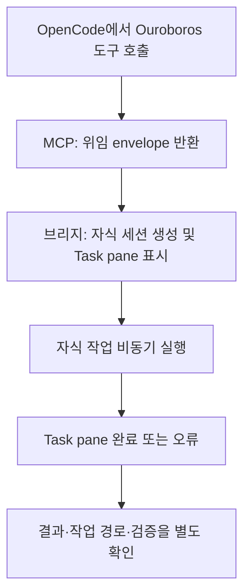

# OpenCode 호스트 브리지와 위임 결과

> **판본과 검증 범위:** 이 안내는 2026-11-04에 조사한 Ouroboros 고정 소스 [`722172ef096767583679d04aef5e847458fee6b2`](https://github.com/Q00/ouroboros/tree/722172ef096767583679d04aef5e847458fee6b2)를 기준으로 한다. 2026-11-06에 확인한 upstream `main` (`592c667f076c3dad7ef68d7844e91480d80135d0`) 및 2026-11-07에 기록된 공개 릴리스 `v0.59.9`와 이 본문의 동등성은 확인하지 않았다. 설치된 호스트 플러그인·MCP 서버의 실제 동작도 미검증이다. 설치판의 도움말·설정·도구 스키마를 먼저 확인하고, 아래 시험 사례를 운영 성공이나 현재판 보장으로 일반화하지 않는다.

기준: 2026-11-04, Ouroboros 고정 소스 [`722172ef096767583679d04aef5e847458fee6b2`](https://github.com/Q00/ouroboros/tree/722172ef096767583679d04aef5e847458fee6b2). [원본 브리지 안내](https://github.com/Q00/ouroboros/blob/722172ef096767583679d04aef5e847458fee6b2/docs/guides/opencode-subagent-bridge.md), [OpenCode 런타임 안내](https://github.com/Q00/ouroboros/blob/722172ef096767583679d04aef5e847458fee6b2/docs/runtime-guides/opencode.md)와 [실행 핸들러](https://github.com/Q00/ouroboros/blob/722172ef096767583679d04aef5e847458fee6b2/src/ouroboros/mcp/tools/execution_handlers.py)를 기준으로 한다. 설치 버전과 OpenCode 버전이 다르면 실제 도움말·구현을 다시 확인한다. 이 조사에서 OpenCode를 설치하거나 실제 자식 작업·모델을 호출하지 않았다.

이 브리지는 OpenCode 대화 안에서 Ouroboros MCP가 반환한 `_subagent` 또는 `_subagents` 요청을 OpenCode의 **자식 세션과 Task pane**으로 연결한다. 일반 [host 실행 런타임](/docs/fanout-detail/)의 `job_wait` → `submit_fanout_results` 루프나 [UserLevel 플러그인](/docs/plugins-detail/)과 같은 구성요소가 아니다. 자식은 별도 모델 실행이며 비용과 파일·도구 효과가 발생할 수 있다.

도식이 화면보다 넓으면 도식 안에서 좌우로 스크롤한다.

## 경로 선택과 설치 전 확인

고정 원본은 `ouroboros setup --runtime opencode`에서 `plugin` 또는 `subprocess` 경로를 선택하도록 설명한다. 전자는 OpenCode 내부 브리지, 후자는 독립 `opencode run` 프로세스다. 원본은 OpenCode **2.x plugin 모드를 미지원**으로 명시하며 감지 시 V1 브리지 설치를 거부한다. subprocess 경로가 host Task pane 위임을 제공한다는 뜻은 아니다. 설치 전에 `opencode --version`, 설치한 Ouroboros의 `ouroboros setup --help`, [런타임 지원](/docs/runtime-support-detail/)을 확인한다.

`setup`은 OpenCode의 MCP·plugin 설정과 브리지 파일을 변경할 수 있다. 원본은 Linux의 XDG 설정 경로, macOS와 Windows의 플랫폼별 경로를 안내한다. 실제 대상과 기존 설정을 확인하고 사용자 권한·비용 범위에 맞게 선택한다. 플러그인 등록 뒤에는 호스트 재시작이 필요할 수 있다. 위 경로는 source 계약이며 이 문서 작성에서 실제 설치·인증·플랫폼별 호환성은 검증하지 않았다.

## 위임과 완료를 구분

브리지는 도구 실행 후 envelope를 읽고 자식 세션을 만든 다음 Task pane을 갱신한다. `out.metadata.ouroboros_dispatch`의 `status`는 `dispatched`, `dispatch_failed`, `skipped`, `nothing`을 구분하며 자식 ID·실패 항목을 포함한다. 원래 MCP의 `job_id`, `session_id`, `status` 등은 존재할 때 `ouroboros_response_shape`에 보존된다. `dispatched`는 **시작 영수증**이며 성공이 아니다. Task pane의 완료·오류와 실제 자식 출력, 작업 위치와 검증 결과를 확인한다. 화면이 없거나 raw envelope가 보이면 브리지 로딩 및 도구 이름·로그를 확인하되 수동으로 작업이 끝났다고 꾸미지 않는다.

`ouroboros_start_execute_seed`와 `ouroboros_start_evolve_step` 등 plugin 위임 경로는 `status=delegated_to_plugin`, `job_id=None`을 반환할 수 있다. 이때 로컬 JobManager job이 없으므로 `ouroboros_job_status(None)`을 폴링하지 않는다. `ouroboros_ralph`도 plugin 위임이면 같은 구분이 필요하다. subprocess 경로의 실제 `job_id`는 [진행 상태](/docs/progress-detail/)에서 조회한다. 동기 도구는 `delegated_to_subagent` 등 다른 응답 모양을 사용할 수 있으므로 실제 연결 서버의 응답을 우선한다.

원본 브리지는 다중 envelope에서 최대 10개를 다루고, 같은 부모 세션·call ID의 짧은 중복 창을 사용한다. 이는 전체 작업의 정확히 한 번 실행이나 서버 재시작을 넘는 멱등성을 보장하지 않는다. 일부 자식만 dispatch 실패할 수 있으므로 각 pane과 `failed`·`skipped`를 확인한다. 자식 prompt 실패는 plugin에서 자동 재시도하지 않으며 timeout·네트워크 실패가 외부 효과의 부재를 증명하지 않는다. 작업자 상태가 불명확하면 재시작 전에 파일·외부 결과를 확인한다.

## 권한·검사·재개 경계

고정 원본 런타임 안내는 plugin 자식에 전체 허용 규칙을 적용한다고 설명하지만, 같은 커밋의 [브리지 구현](https://github.com/Q00/ouroboros/blob/722172ef096767583679d04aef5e847458fee6b2/src/ouroboros/opencode/plugin/ouroboros-bridge.ts)은 다르다. 자식 생성 전 부모 세션과 대상 agent의 권한 스냅샷을 조회하고, 부모의 `external_directory` 규칙과 모든 `deny` 규칙을 자식 세션에 보존한다. 대상 agent가 `task` 또는 `todowrite` 권한을 선언하지 않으면 해당 도구의 `deny`를 추가한다. 다른 agent 규칙은 agent 소유로 남고 자식 세션 규칙에 복사되지 않는다. 부모 또는 agent 정보를 신뢰할 수 없으면 해당 dispatch를 실패 처리한다. 이는 고정 소스의 정적 확인이며 실제 OpenCode 버전의 유효 권한을 시험한 것은 아니다.

별도 subprocess 경로의 Seed 실행은 bypass 모드를 강제한다. plugin 자식의 유효 권한은 호스트·부모·agent 정책에 따라 확인해야 하며, 브리지의 별도 세션이나 일부 거부 규칙만으로 OS·네트워크 격리나 사용자 승인 경계를 보장하지 않는다. 신뢰할 수 있는 작업공간과 도구만 제공한다.

plugin 위임 실행에서는 검사 패키지 경계가 적용되지 않아 `check_package: not_applied`, `check_package_reason: plugin_dispatch`가 보고될 수 있다. 또한 일부 typed evidence/검증을 요구하는 실행 모드는 위임 경로가 강제하지 못해 거부되거나 기본 동작이 downgrade로 표시될 수 있다. 출력의 실제 모드와 검증 근거를 확인하며 별도 [검사 패키지 안내](/docs/check-package-detail/)를 따른다.

브리지는 이미 발행된 자식을 재시작 뒤 내구적으로 다시 연결하지 못하므로 plugin 실행의 resume을 보장하지 않는다. `ouroboros_evolve_step`/`ouroboros_start_evolve_step`에서 비기본 `commit_policy`, `auto_session_id`, `execution_id`, `checkpoint_commits`, `checkpoint_attempted_ac_ids`, `recover_expired_claim`은 plugin이 처리하지 못해 요청이 거부된다. 해당 기능이 필요하면 설치 버전이 제공하는 in-process 경로와 기존 작업 상태를 확인한다. 새 작업을 중복 시작하기 전에 [복구 안내](/docs/recovery-detail/)와 실제 작업 위치·외부 효과를 먼저 확인한다.

**검증 범위:** 고정 커밋과 관련 경로가 같은 checkout의 기존 대역 테스트에서 plugin 관련 5개가 통과했고 19개는 선택되지 않았다. 이는 checkpoint 옵션·멱등성·검사 패키지 경계의 선택된 테스트일 뿐 실제 OpenCode UI·호스트 재시작·모델 호출·권한 격리·외부 효과를 검증하지 않는다. 원본 안내의 시간 수치나 fan-out 한도는 고정 source의 구현 설명이며 현재 설치된 다른 버전의 성능 보장이 아니다.
