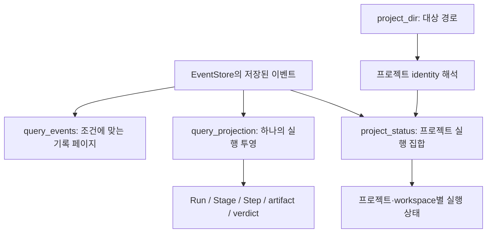

# 이벤트·실행 투영·프로젝트 상태 조회

!!! warning "판본과 검증 범위"
    이 문서의 상세 설명과 합성 관찰은 별도 표시가 없으면 2026-11-04 조사한 제품 소스 [`722172ef`](https://github.com/Q00/ouroboros/tree/722172ef096767583679d04aef5e847458fee6b2) 기준입니다. 제품 main [`592c667f`](https://github.com/Q00/ouroboros/tree/592c667f076c3dad7ef68d7844e91480d80135d0), 공개 패키지 `0.59.9`, 호스트 플러그인·MCP 서버는 별도 판본입니다. 합성·대역 사례는 표시된 조건에 한정되며 실제 모델, 운영 데이터 또는 전체 호스트를 검증하지 않습니다. 현재 설치의 도움말과 [제품 문서](https://github.com/Q00/ouroboros/tree/592c667f076c3dad7ef68d7844e91480d80135d0/docs)를 대조하고 구판과 동일하게 동작한다고 가정하지 마세요.


기준: 2026-11-04, Ouroboros 고정 소스 [`722172ef096767583679d04aef5e847458fee6b2`](https://github.com/Q00/ouroboros/tree/722172ef096767583679d04aef5e847458fee6b2). 세 이름은 **MCP 도구**이며 아래 JSON은 호스트가 연결된 서버에 전달할 인자 예시다. 셸 명령이 아니다. 설치된 서버의 `list_tools`와 반환 결과를 먼저 확인한다. 실제 ID와 프로젝트 경로만 사용하고, 다른 사람의 데이터나 인증정보를 출력·공유하지 않는다.

이벤트는 저장된 관찰 기록이고, Run/Stage/Step은 그 기록에서 만든 투영이며, 프로젝트 상태는 여러 실행을 묶어 재구성한 결과다. 어느 것도 현재 프로세스의 생존, 외부 서비스의 실제 효과 또는 작업의 품질을 단독으로 보증하지 않는다. 받은 job·session·execution ID를 구분하려면 [생명주기](/docs/lifecycle-detail/)와 [진행상태](/docs/progress-detail/)를 먼저 본다.

도식이 화면보다 넓으면 도식 안에서 좌우로 스크롤한다.



## 1. 특정 세션의 이벤트 살펴보기

**표시 범위:** 고정 `722172ef`, 개발 소스 `592c667f`, 공개 릴리스 `0.59.9`의 `ouroboros_query_events` 텍스트 응답은 각 이벤트의 `data`를 문자열로 바꾼 뒤 길면 앞 100자와 말줄임표만 표시한다. 응답의 페이지 메타데이터도 전체 payload를 제공하지 않는다. 같은 세 소스에서 `ouroboros status execution <execution_id> --events`는 시각·이벤트 유형·상태를 표로 보여 주며 전체 payload는 표시하지 않는다. 따라서 표시 내용만으로 뒤에 생략된 세부사항이나 외부 효과의 부재를 판단하지 않는다. 설치된 호스트·서버의 실제 출력은 해당 버전에서 확인한다. [이벤트 표시 722](https://github.com/Q00/ouroboros/blob/722172ef096767583679d04aef5e847458fee6b2/src/ouroboros/mcp/tools/query_handlers.py#L570-L581) · [개발 소스](https://github.com/Q00/ouroboros/blob/592c667f076c3dad7ef68d7844e91480d80135d0/src/ouroboros/mcp/tools/query_handlers.py#L570-L581) · [릴리스](https://github.com/Q00/ouroboros/blob/5f5fca90662861201ff0a26f502edd22b272c4c6/src/ouroboros/mcp/tools/query_handlers.py#L570-L581) · [CLI 표시 722](https://github.com/Q00/ouroboros/blob/722172ef096767583679d04aef5e847458fee6b2/src/ouroboros/cli/commands/status.py#L609-L619) · [개발 소스](https://github.com/Q00/ouroboros/blob/592c667f076c3dad7ef68d7844e91480d80135d0/src/ouroboros/cli/commands/status.py#L609-L619) · [릴리스](https://github.com/Q00/ouroboros/blob/5f5fca90662861201ff0a26f502edd22b272c4c6/src/ouroboros/cli/commands/status.py#L609-L619).

실제 `session_id`를 알고 있을 때 연결된 서버에서 다음과 같은 인자를 `ouroboros_query_events`에 전달한다. 값을 임의로 만들거나 다른 종류의 ID를 대입하지 않는다.

```json
{"session_id":"<실제 세션 ID>","limit":50,"offset":0}
```

선택적 `event_type`으로 유형을 좁힐 수 있다. 기본 `limit`은 50, `offset`은 0이며 다음 페이지는 실제 반환 건수와 조건을 확인하면서 조회한다. 응답의 `meta.total_events`는 **이번 페이지의 건수**이지 전체 일치 건수가 아니다. 출력의 `Data`는 긴 경우 앞 100자만 보여 주므로 전체 payload나 정확한 자료 삭제 여부를 추정할 수 없다. `session_id`가 비어 있거나 없으면 핸들러는 **모든 세션에 걸쳐** 조회한다. 개인정보·다른 작업 내용이 드러날 수 있으므로 진단 범위가 특정 세션이면 ID를 명시한다. [이벤트 조회 구현](https://github.com/Q00/ouroboros/blob/722172ef096767583679d04aef5e847458fee6b2/src/ouroboros/mcp/tools/query_handlers.py).

고정 stdio MCP 서버와 Python MCP SDK를 이용한 별도 합성 SQLite 시험에서는 일치 이벤트가 3개일 때 `limit=1`의 첫 두 페이지 `meta.total_events`가 각각 1, `offset=3`의 빈 페이지가 0이었다. 이는 한 페이지의 반환 수라는 설명을 해당 전송 경로에서 확인한 사례다. 이 시험은 동시에 이벤트가 추가되는 경우, 다른 SDK·호스트·운영 데이터나 전체 결과 수를 검증하지 않았다.

**변경 중인 이력의 offset:** 저장소 조회는 timestamp 내림차순과 ID 내림차순으로 정렬하고 요청마다 `LIMIT`·`OFFSET`을 적용한다. 페이지 사이에 앞쪽으로 정렬되는 이벤트가 추가되면 같은 이벤트가 다시 나타날 수 있으므로, 페이지 수를 더한 값이나 마지막 페이지의 빈 응답만으로 일관된 전체 스냅샷을 보장하지 않는다. 메모리 SQLite에 서로 다른 시각의 합성 이벤트 3개를 넣고 첫 페이지를 읽은 뒤 더 최근 이벤트를 추가한 직접 저장소 시험에서 `limit=1, offset=0`과 이후 `offset=1`은 같은 이벤트를 반환했다. 고정 stdio MCP 서버·SDK에서도 별도 임시 파일 DB의 합성 이벤트 3개에 같은 순차 삽입을 적용하자 두 페이지가 같은 이벤트 ID를 반환했다. 이 전송 시험은 `session_id` 없이 전체 세션을 조회했으며, 동시 트랜잭션·운영 DB·세션 필터는 시험하지 않았다. 일관된 감사가 필요하면 쓰기 중단 또는 별도 스냅샷을 확보하는 운영 절차와 확인된 백업을 사용하고, 이벤트 ID를 비교해 중복을 식별한다. ID 중복 제거만으로 누락이 없다고 보장하지 않는다. [고정 저장소 구현](https://github.com/Q00/ouroboros/blob/722172ef096767583679d04aef5e847458fee6b2/src/ouroboros/persistence/event_store.py).

**페이지 경계:** 이 고정 핸들러는 `limit`과 `offset`의 양수 범위를 직접 검증하지 않고 저장소에 전달한다. 따라서 호출자는 `limit`에 양의 정수, `offset`에 0 이상의 정수를 지정하고, 응답의 페이지 건수와 오류를 확인한다. 격리된 메모리 SQLite에 합성 이벤트 3개를 넣고 실제 핸들러를 직접 호출한 시험에서는 `limit=0`이 빈 페이지, `limit=-1`이 3개 전부, `limit=1, offset=-1`이 1개를 반환했다. 이 관찰은 해당 SQLite·의존성 및 합성 데이터의 한 사례이며 다른 데이터베이스나 MCP 전송에서 음수의 의미를 보장하지 않는다. 특히 음수 limit을 안전한 읽기 상한이나 유효성 오류로 가정하지 않는다. 실제 서버·운영 데이터는 시험하지 않았다. [핸들러](https://github.com/Q00/ouroboros/blob/722172ef096767583679d04aef5e847458fee6b2/src/ouroboros/mcp/tools/query_handlers.py), [저장소](https://github.com/Q00/ouroboros/blob/722172ef096767583679d04aef5e847458fee6b2/src/ouroboros/persistence/event_store.py).

페이지는 timestamp 내림차순에 `offset`을 적용한다. 조회 도중 새 이벤트가 추가되면 같은 offset이 가리키는 행이 바뀌어 페이지 사이에 중복이나 누락이 생길 수 있다. 세션 관련 조회는 동일 timestamp의 추가 정렬 기준을 지정하지 않는다. 따라서 여러 페이지를 이어 읽었다는 사실만으로 한 시점의 완전한 스냅샷을 얻었다고 판단하지 않는다. 필요하면 조회 시각·필터·반환 ID를 보존하고 실행 상태 및 목적에 맞는 다른 증거와 대조한다. [이벤트 저장소 조회 구현](https://github.com/Q00/ouroboros/blob/722172ef096767583679d04aef5e847458fee6b2/src/ouroboros/persistence/event_store.py).

또한 세션의 `orchestrator.session.started` 행이 있으면, 이 조회는 가장 이른 시작 timestamp 이상인 관련 이벤트만 반환한다. 생산자 시계가 역행하거나 이전 시각으로 기록된 관련 이벤트는 저장되어 있어도 빠질 수 있다. 시작 행을 찾지 못하면 이 timestamp 경계는 적용되지 않는다. 내부 증분 조회 `query_session_related_events_after`에는 별도로 `session_start_by_rowid=True`를 지정해 저장 rowid를 세션 시작 경계로 쓰는 경로가 있지만, 위 MCP 도구가 그 옵션을 노출한다는 뜻은 아니다. 어느 경로든 결과가 모든 외부 효과의 완전한 기록임을 보장하지 않는다. [시작 경계 확인 구현](https://github.com/Q00/ouroboros/blob/722172ef096767583679d04aef5e847458fee6b2/src/ouroboros/persistence/event_store.py).

이 핸들러가 자체 `EventStore`를 만들면 기본 writable 경로의 `initialize()`를 호출한다. 따라서 조회가 항상 파일 변경이 없는 작업이라고 가정하지 않는다. 서버가 주입한 저장소의 설정·초기화와 로그도 다를 수 있다. 기존 데이터의 보존이 중요하면 실행 환경과 백업 경계를 먼저 확인한다.

## 2. 하나의 실행을 Run/Stage/Step으로 보기

`ouroboros_query_projection`은 `session_id` 또는 `execution_id` 중 **최소 하나**가 필요하다. MCP 입력 스키마에서 둘 다 선택적으로 보이는 것은 둘 다 생략해도 된다는 뜻이 아니다. 예를 들어 실제 세션과 실행의 연결을 이미 확인했다면 다음과 같이 전달한다.

```json
{"session_id":"<실제 세션 ID>","execution_id":"<그 세션에 속한 실제 실행 ID>"}
```

두 ID가 서로 맞지 않으면 오류다. 세션에서 여러 실행이 선언되거나 참조되면 `execution_id`를 지정해야 모호하지 않다. 이벤트가 없으면 빈 실행의 성공 결과가 아니라 오류다. 선택적 `seed_id`는 표시·투영용 override이며 실제 Seed의 출처를 증명하지 않는다. 이 소스의 응답 `meta`에는 `run`, `stages`, `steps`, `artifacts`, `verdicts`, 이벤트 수와 `seed_id_source`가 포함된다. 이벤트에서 Seed ID를 얻지 못하면 조회 ID를 fallback으로 쓸 수 있으므로 출처 필드를 함께 확인한다. [투영 핸들러](https://github.com/Q00/ouroboros/blob/722172ef096767583679d04aef5e847458fee6b2/src/ouroboros/mcp/tools/projection_handlers.py), [투영 구조](/docs/architecture-detail/).

`limit`은 페이지 크기가 아닌 **완전한 투영을 위한 관련 이벤트 수 상한**이다. 양의 정수만 허용하며 생략하면 상한을 지정하지 않는다. 관련 이벤트가 상한을 넘으면 일부 투영을 반환하지 않고 오류를 낸다. 오류의 수와 저장소 규모를 확인한 뒤 적절한 범위로 재조회한다. 소스는 이벤트를 불러온 뒤 상한을 검사하므로 `limit`을 메모리·읽기 비용의 확실한 상한으로 취급하지 않는다.

## 3. 프로젝트 범위의 실행 상태 보기

`ouroboros_project_status`에 실제 프로젝트 경로를 지정한다. 서버가 시작될 때 포착한 호출자 디렉터리가 기본일 수 있으므로, 여러 저장소를 다룬다면 명시하는 편이 안전하다.

```json
{"project_dir":"<실제 프로젝트 경로>","limit":100}
```

선택적인 `workspace`는 정규화된 **프로젝트 상대 경로**다. 프로젝트 identity 충돌, 투영 실패 또는 일치 실행 수가 상한을 초과하면 부분 레코드 대신 오류를 반환한다. 기본 `limit`은 100이며 양의 정수여야 한다. 출력을 공유하기 전 경로·작업 ID·내용의 민감성을 확인한다. 성공한 구조화 결과와 `meta.project_id`, `run_count`는 조회된 해당 프로젝트 범위의 결과이며 다른 저장소의 작업이나 외부 서비스의 실제 상태를 대변하지 않는다. [프로젝트 상태 핸들러](https://github.com/Q00/ouroboros/blob/722172ef096767583679d04aef5e847458fee6b2/src/ouroboros/mcp/tools/project_status_handler.py).

독립 CLI에서도 같은 프로젝트 상태 핸들러를 사용한다. 여러 저장소를 다루는 경우 아래 경로를 실제 대상에 맞게 바꾸고 명시한다. `--workspace`는 필요할 때만 프로젝트 상대 경로로 지정한다.

```bash
ouroboros status project /path/to/project
ouroboros status project /path/to/project --workspace packages/app --limit 100 --json
```

경로를 생략하면 CLI를 실행한 현재 디렉터리가 대상이다. `--json`은 핸들러의 구조화된 ProjectRecord를 출력하며 성공 시 종료 0이다. `--limit`은 양의 정수로, 개수 초과를 조용히 잘라서 보여주는 페이지 크기가 아니다. 고정 CLI에서는 잘못된 limit 또는 앞뒤 공백이 있는 workspace가 종료 64이고, 조회 실패 또는 JSON 구조 부재가 종료 1이다. 오류를 빈 실행 목록이나 성공으로 해석하지 않는다. [CLI 구현](https://github.com/Q00/ouroboros/blob/722172ef096767583679d04aef5e847458fee6b2/src/ouroboros/cli/commands/status.py).

빈 임시 HOME·프로젝트에서 실제 CLI `--help`는 종료 0, `--limit 0`은 종료 64였고, 기존 이력 DB가 없는 `--json`은 종료 1로 전체 이력을 열거할 수 없다고 보고했다. 별도 임시 HOME·Git 프로젝트와 합성 시작 이벤트 1개를 저장한 DB에서는 실제 `status project PROJECT --json`이 종료 0과 `run_count: 1`, 해당 합성 session의 `status: running`을 반환했다. 이는 이벤트에서 재구성한 상태이며 실제 실행 중 프로세스의 존재를 뜻하지 않는다. 관련 CLI·핸들러·투영·저장·프로젝트 식별 파일은 고정 소스와 일치함을 확인했다. 운영 DB·실제 실행 중 프로세스·동시 쓰기는 검증하지 않았다. telemetry를 비활성화했으며 OS 수준 네트워크 격리는 적용하지 않았다.

투영과 프로젝트 상태 핸들러가 **자체 저장소를 여는 경우**, 고정 소스는 read-only `EventStore`를 `create_schema=False`로 연다. 주입된 저장소·서버 초기화·로그 및 다른 버전의 모든 부작용까지 보장한다는 뜻은 아니다. DB나 스키마가 없는 오류를 해결하려고 사용자 DB를 삭제·초기화하지 않는다. [설정과 진단](/docs/operations-detail/)에서 실제 데이터 위치와 설치 판본을 확인한다.

## 오류를 해석할 때

- `session_id or execution_id is required`: 같은 이름의 다른 ID를 추측하지 말고 시작 응답 또는 상태 기록에서 연결된 값을 찾는다.
- 여러 execution 또는 소속 불일치: 실제 세션과 실행의 결합을 확인해 하나의 실행을 명시한다. 조회를 위해 새 작업을 시작하지 않는다.
- 이벤트 없음, DB·스키마 없음: 연결된 호스트·프로젝트·저장 위치와 버전을 확인한다. 결과가 없다는 것은 실행이 성공했거나 외부 작업이 없었다는 증거가 아니다.
- `limit` 초과 또는 project identity 충돌: 오류를 보존하고 범위·ID·상한을 검토한다. 잘린 부분이 완전한 결과라고 가정하지 않는다.

**검증 범위:** 고정 커밋과 해당 핸들러 경로에 차이가 없는 로컬 checkout에서 임시 HOME·TMPDIR 및 telemetry 비활성 조건으로 `tests/unit/mcp/tools/test_project_status_handler.py`, `tests/unit/harness/test_projection_builder.py`의 기존 대역 테스트 **39개**가 통과했다. 이 검사는 프로젝트 상태의 read-only 및 완전성 조건과 투영 빌더의 사례를 포함하지만, 실제 호스트 연결·모든 query 입력 조합·운영 DB·모델 실행·OS 네트워크 격리를 증명하지 않는다. 추가로 빈 임시 HOME·TMPDIR과 telemetry 비활성 조건에서 기존 `TestQueryEventsHandler`와 `TestProjectionQueryHandler` 테스트 **23개**가 통과했다. 이 테스트 역시 실제 서버·모든 입력 조합·OS 네트워크 격리나 동시 페이지 조회의 스냅샷 보장을 증명하지 않는다. 위 JSON은 형식 예시로 실제 서버에 호출하지 않았다.
