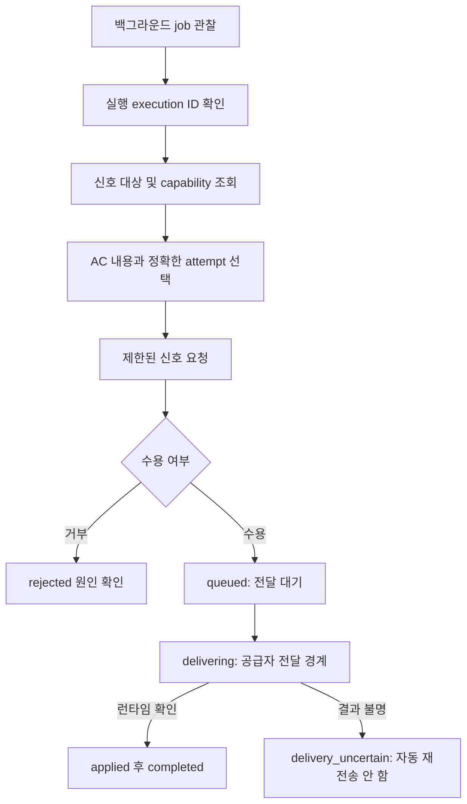

# 진행 중인 작업 관찰과 Synapse 신호

기준: Ouroboros upstream [`722172ef096767583679d04aef5e847458fee6b2`](https://github.com/Q00/ouroboros/tree/722172ef096767583679d04aef5e847458fee6b2), 2026-11-04. 이 페이지는 고정 소스의 MCP 서버와 구현을 읽어 정리했다. **실제 공급자 모델, 신호 전달, 재시작 복구를 이 문서 작성 중 실행하지 않았다.** 연결된 서버의 `list_tools` 결과와 런타임이 반환한 현재 capability를 우선한다. [MCP 도구·입력 색인](/docs/mcp-reference-detail/)과 [생명주기·저장](/docs/lifecycle-detail/)도 참고한다.

**판본 경계:** 아래 신호 계약·기본 adapter 능력은 고정 722판의 [SessionSignal model](https://github.com/Q00/ouroboros/blob/722172ef096767583679d04aef5e847458fee6b2/src/ouroboros/core/session_signal.py), [Synapse mailbox](https://github.com/Q00/ouroboros/blob/722172ef096767583679d04aef5e847458fee6b2/src/ouroboros/orchestrator/synapse.py), [MCP handler](https://github.com/Q00/ouroboros/blob/722172ef096767583679d04aef5e847458fee6b2/src/ouroboros/mcp/tools/synapse_handler.py), [설계 계약](https://github.com/Q00/ouroboros/blob/722172ef096767583679d04aef5e847458fee6b2/docs/active-conductor/synapse-clean-room-spec.md)을 근거로 한다. 이 인용 파일들을 공개 main [`592c667f`](https://github.com/Q00/ouroboros/tree/592c667f076c3dad7ef68d7844e91480d80135d0) 및 release `v0.59.9`와 정적으로 비교했을 때 차이가 보이지 않았다. 이는 선택 source 경로의 대조이며 현재 설치 server, runtime capability, 공급자별 적용·재시작 복구의 호환성 확인은 아니다. 실행 전 연결 서버가 실제 반환한 대상·모드·schema와 현재 진행 상태를 확인한다.

Synapse는 실행 중인 하나의 승인 기준(AC) **정확한 시도**에 제한된 의도를 보내는 기능이다. 진행 관찰과 신호 요청은 별개이며, 신호의 대기열 등록은 작업자가 내용을 적용했다는 뜻이 아니다. Active Conductor의 후속 실행 결정은 Synapse로 한 작업자에게 메시지를 보내는 일과 또 다른 경로다.

도식이 화면보다 넓으면 도식 안에서 좌우로 스크롤한다.



## 1. 실행을 관찰하고 대상을 찾기

1. 시작 도구가 반환한 **job ID**로 `ouroboros_job_status`나 `ouroboros_job_wait`를 호출해 실행의 현황과 **execution ID**를 확인한다. 둘은 다른 식별자이므로 job ID를 execution ID로 바꾸어 넣지 않는다. `ouroboros_job_wait`는 기본값이 즉시 반환이고 명시적 `timeout_seconds`는 최대 5초로 제한된다. 상태·결과 도구와 OpenCode 플러그인의 별도 경로는 [작업 상태](/docs/progress-detail/), [MCP 색인](/docs/mcp-reference-detail/)을 따른다.
2. `ouroboros_session_signal_targets`에 `execution_id`를 전달한다. 결과에는 활성 AC 내용, 논리 `session_scope_id`, **현재** `session_attempt_id`와 그 시도의 지원 모드가 들어 있다. 사용자 의도와 AC 내용을 대조해 하나를 고른다. 빈 목록은 이 조회에서 활성 시도를 찾지 못했다는 뜻이며 일반적으로 작업 완료나 전송 성공을 의미하지 않는다. 조회 이후 시도가 끝나거나 바뀔 수 있으므로 오래된 대상은 전송 시 거부될 수 있다.
3. 해당 시도가 광고한 모드를 기준으로 `ouroboros_session_signal`을 호출한다. 현재 제공 어댑터가 직접 광고·적용하는 모드는 `inform`과 `after_turn`뿐이다. 어떤 런타임이 설치돼 있다는 사실만으로 특정 시도가 이 모드를 광고한다고 가정하지 않는다.

다음은 **MCP 도구 이름과 JSON 인자 예시**다. 셸 명령이 아니며, 꺾쇠 표시는 실제 조회에서 얻은 값으로 바꿔야 한다. 현재 대상이 `after_turn`을 광고하고 기존 목표·AC·제약을 바꾸지 않는 보완 지시인 경우에만 사용한다.

```json
{
  "target_session_scope_id": "<조회한 scope ID>",
  "target_session_attempt_id": "<조회한 attempt ID>",
  "expected_execution_id": "<조회한 execution ID>",
  "mode": "after_turn",
  "message": "기존 수락 기준을 유지하면서 실패 사례도 확인해 주세요.",
  "source": "user",
  "contract_effect": "additive",
  "reason": "기존 검증을 보완합니다.",
  "idempotency_key": "<이 정확한 의도에 고유한 안정적인 키>"
}
```

이 객체를 `ouroboros_session_signal`의 인자로 전달한다. 재시도에는 동일한 실행·scope·attempt·idempotency key와 동일한 요청을 사용한다. 같은 식별자를 다른 불변 요청에 재사용하면 오류다. 새 시도에 과거 attempt ID를 재사용하지 말고 다시 조회한다. `source`는 실제 출처(`user`, `conductor`, `worker`)를 기록하고, 선택적인 `expires_at`은 시간대가 있는 ISO-8601이어야 한다. 메시지·이유는 제한된 길이이며 비밀값이나 대화 전문을 넣지 않는다. 비밀 형태 감지는 완전한 데이터 유출 방지가 아니다. [신호 검증과 식별자 구현](https://github.com/Q00/ouroboros/blob/722172ef096767583679d04aef5e847458fee6b2/src/ouroboros/core/session_signal.py), [MCP 핸들러](https://github.com/Q00/ouroboros/blob/722172ef096767583679d04aef5e847458fee6b2/src/ouroboros/mcp/tools/synapse_handler.py).

## 2. 모드와 승인 경계

| 요청 모드 | 이 판본에서 해석할 내용 |
| --- | --- |
| `inform` | 정보를 전달하고 제한된 응답을 받을 수 있다. 실행 방향 변경을 보장하지 않는다. 구현은 응답 턴에 `tools=[]`를 요청하지만, 런타임이 빈 도구 목록을 강제하지 못하는 경우가 있으므로 이것만을 보안 경계로 쓰지 않는다. |
| `after_turn` | 현재 작업자 턴이 끝난 다음 전달한다. 즉시 중단하거나 현재 모델·도구 호출을 바꾸는 명령이 아니다. |
| `redirect` | 체크포인트 전환 능력으로 예약돼 있다. 제공 어댑터는 직접 광고하지 않는다. 단, 대상이 `after_turn`을 광고하고 `fallback_mode: "after_turn"`을 명시한 경우에만 요청이 그 모드로 대체될 수 있다. 이는 즉시 redirect가 아니다. |
| `replace` | 소유 작업의 중단과 대체 재개 능력으로 예약돼 있고 승인 이벤트가 필요하다. 제공 어댑터는 현재 직접 광고·적용하지 않으므로 사용 가능하다고 가정하지 않는다. |

승인된 목표·AC·제약·비목표를 바꾸는 `contract_effect: "specification_change"`는 한 AC에 주입할 수 없어 거부된다. 승인 이벤트 ID를 제공해도 이 경계가 없어지지 않는다. 공유 계약을 바꾸는 경우 승인과 후속 실행의 별도 경로가 필요하다. `source`의 대기 신호 우선순위는 user > conductor > worker다. [메일박스 구현](https://github.com/Q00/ouroboros/blob/722172ef096767583679d04aef5e847458fee6b2/src/ouroboros/orchestrator/synapse.py), [구현 범위와 능력 표](https://github.com/Q00/ouroboros/blob/722172ef096767583679d04aef5e847458fee6b2/docs/active-conductor/synapse-clean-room-spec.md).

## 3. 전달 결과 확인과 복구

요청 응답의 `meta.state`, `effective_mode`, `signal_id`, `application_proven`을 확인한다. `queued`는 영속 대기열에 들어갔다는 뜻이고 `delivering`은 공급자 전달이 시작된 경계다. 둘 다 적용 성공이 아니다. `applied`는 런타임 확인이 들어온 상태이며 `completed`는 신호 처리의 종료다. 이것도 전체 AC나 작업의 성공 판정과는 다르다. `rejected`는 대상·만료·모드·계약 등의 거부 원인을 확인한다. `delivery_uncertain`은 공급자 적용 여부를 입증할 수 없는 종료 상태이며 자동으로 다시 보내지 않는다. 대상과 남은 작업을 확인하고 외부 효과의 중복 가능성을 판단한다.

연결된 job이 있다면 `ouroboros_job_wait`에 `stream: "linked"`, `wait_for: "attention_or_ac_change"`와 이전 응답의 `cursor`를 전달해 관련 신호·진행 이벤트를 관찰한다. 반환된 cursor를 이어 사용하고 추가 페이지가 있으면 이어 읽는다. `ouroboros_job_result`는 완료된 job의 결과를 조회한다. 신호 결과와 job의 최종 판정을 따로 확인한다. 구현은 재시작 시 여전히 queued인 신호의 재생과, 이미 전달을 맡았지만 공급자 확인이 없는 신호의 `delivery_uncertain` 처리를 구분한다. 이는 모든 호스트에서 프로세스 재시작이나 외부 효과의 복구가 보장된다는 뜻이 아니다. [작업 관찰 핸들러](https://github.com/Q00/ouroboros/blob/722172ef096767583679d04aef5e847458fee6b2/src/ouroboros/mcp/tools/job_handlers.py), [복구 안내](/docs/recovery-detail/).

## Active Conductor의 별도 결정

관찰 이벤트가 후속 조치를 제안하더라도 메시지 하나만 보고 자동으로 기존 실행을 중복 시작하지 않는다. 이 판본의 `ouroboros_record_conductor_decision`은 `selected`, `completed`, `failed`, `declined` 단계를 기록한다. `selected`에는 관찰 이벤트·근거 이벤트·읽기 전용 검증 요약·선택한 행동과 효과 등의 입력이 필요하다. 변경을 수행하는 후속 결정은 엔진 소유 상태가 `closed`여야 하며, 명세 변경에는 승인 영수증이 필요하다. 정확한 입력과 조건은 [MCP 색인](/docs/mcp-reference-detail/)과 [결정 핸들러](https://github.com/Q00/ouroboros/blob/722172ef096767583679d04aef5e847458fee6b2/src/ouroboros/mcp/tools/conductor_handler.py)를 확인한다. 결정 기록 자체가 후속 실행을 시작했거나 성공했음을 뜻하지 않는다.

**검증 범위:** 위 설명은 고정 커밋의 MCP 정의, 신호·메일박스·관찰·결정 구현 및 원본 설계 문서 대조다. 설계 문서의 과거 공급자 시험 기록을 이번 시험 결과로 옮기지 않았다. 실제 호스트별 도구 노출·동시성·공급자 인증·실행·후속 효과는 각 환경에서 별도로 검증해야 한다.

고정 소스의 단위 통합 시험 세 건을 2026-11-04 격리 환경에서 추가 실행했다. 실제 EventStore·메일박스·실행기를 사용하고 공급자 런타임은 합성한 조건에서, after-turn 요청이 queued→delivering→applied→completed로 기록된 사례, 후속 런타임이 오류만 반환해 `delivery_uncertain`으로 끝난 사례, 소비 전에 만료된 요청이 `expired_before_delivery`로 거부된 사례가 통과했다. 이는 테스트가 구성한 세 경로이며 실제 공급자·호스트·외부 효과·재시작 복구를 입증하지 않는다. 첫 시험의 코드 판본이 달라 근거에서 제외했고 이후 고정 소스 기준으로 재시험한 사실을 반영했다. 상세한 내부 재현 기록은 공개되지 않으며, 이 관찰만으로 실제 복구를 보장하지 않는다.
