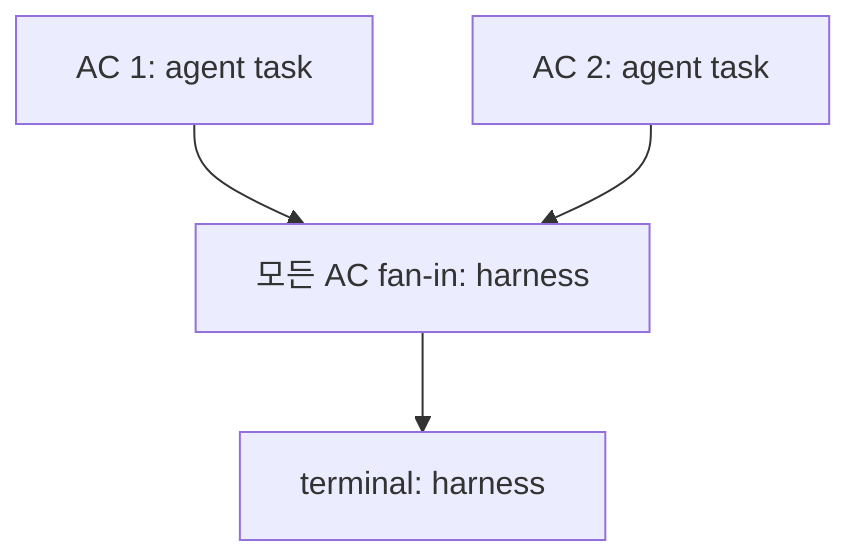

# Workflow IR: 계획을 투영하고 검사하기

기준: 2026-11-04, Ouroboros source [`722172ef096767583679d04aef5e847458fee6b2`](https://github.com/Q00/ouroboros/tree/722172ef096767583679d04aef5e847458fee6b2). 이 안내는 [CLI](https://github.com/Q00/ouroboros/blob/722172ef096767583679d04aef5e847458fee6b2/src/ouroboros/cli/commands/workflow_ir.py), [Seed 어댑터](https://github.com/Q00/ouroboros/blob/722172ef096767583679d04aef5e847458fee6b2/src/ouroboros/orchestrator/workflow_ir_adapter.py), [그래프 모델·검증기](https://github.com/Q00/ouroboros/blob/722172ef096767583679d04aef5e847458fee6b2/src/ouroboros/orchestrator/workflow_ir.py)와 [v1 경계](https://github.com/Q00/ouroboros/blob/722172ef096767583679d04aef5e847458fee6b2/docs/agentos/workflow-ir-v1.md)를 대조한다. 설치한 버전이 다르면 해당 버전의 도움말과 구현을 먼저 확인한다.

**판본 경계:** CLI, adapter, graph model/validator 파일을 722판, 공개 `v0.59.9`, main [`592c667f`](https://github.com/Q00/ouroboros/tree/592c667f076c3dad7ef68d7844e91480d80135d0)에서 정적으로 대조했을 때 이 파일 경로에는 소스 차이가 보이지 않았다. 이는 선택 파일의 코드 비교이지 의존성·설치 artifact·실행 환경까지의 동등성 확인은 아니다. 실제 호스트·사용자 Seed·모델·dispatch는 시험하지 않았다. 아래 명령은 해당 CLI를 설치한 사용자가 직접 실행하기 전 도움말과 경로를 확인하는 예시다.

Workflow IR은 **실행 계획의 구조와 적합성을 표현하는 내부 계약**이다. Seed를 대체하거나 워크플로를 실행하는 엔진이 아니다. `inspect`가 `Validation: ok`를 출력해도 실제 작업 실행·테스트 통과·결과 품질이나 외부 행동의 성공은 증명되지 않는다. 모델·플러그인·외부 도구를 이 명령으로 실행하지 않는다. `--json`에는 수용 기준 원문 등 metadata가 포함되므로 공유 전 민감정보를 확인한다.

## Seed에서 계획 살펴보기

독립 CLI가 설치돼 있고 실제 Seed 경로가 있을 때 다음을 사용한다. 호스트의 `ooo` 스킬 명령이 아니다.

```text
ouroboros workflow-ir inspect --help
ouroboros workflow-ir inspect /path/to/seed.yaml
ouroboros workflow-ir inspect /path/to/seed.yaml --json
```

`--json`은 `seed_file`, `workflow_spec`, `validation` 객체를 출력한다. 표준 출력 저장·공유는 사용자 선택이며 파일에 실제 내용을 기록할 수 있다. 조사 시 빈 임시 HOME에서 telemetry를 끈 조건으로 아래 **합성 Seed**를 사용했다. 현재 프로젝트의 실행을 권하는 명령이 아니다.

```yaml
goal: "Inspect offline task"
acceptance_criteria:
  - "A test passes"
  - description: "README describes usage"
ontology_schema:
  name: "Task"
  description: "Local task"
metadata:
  seed_id: "workflow_ir_demo"
  ambiguity_score: 0.1
```

이 예제에서 일반 출력은 `WorkflowSpec: wfspec_workflow_ir_demo`, `Nodes: 4`, `Edges: 3`, `Validation: ok`였고, JSON에서 `seed_ac_001`, `seed_ac_002`, `seed_ac_join`, `seed_terminal`을 확인했다. 앞의 두 노드는 각각 수용 기준 하나에 해당하고 agent가 소유하는 task 계획이다. 두 task에서 harness 소유 fan-in barrier로 모인 후 terminal로 이어진다. 이것은 그래프의 계획 표현이지 실제 두 작업이 실행됐다는 뜻이 아니다. [Seed YAML 형식](/docs/seed-format-detail/)과 함께 사용한다.

도식이 화면보다 넓으면 도식 안에서 좌우로 스크롤한다.



CLI는 YAML mapping을 읽어 Seed 모델로 검증하고 어댑터가 WorkflowSpec을 만든 뒤 그래프를 검증한다. Seed 모델이 빈 `acceptance_criteria`를 허용하더라도 이 투영은 **비어 있지 않은 수용 기준 1개 이상과 공백이 아닌 `metadata.seed_id`**를 요구한다. 단, YAML에서 `metadata.seed_id`를 생략하면 Seed 모델이 읽을 때 새 ID를 자동 생성하므로 생략 자체는 거부되지 않는다. 자동 ID는 다시 읽을 때 달라질 수 있으므로 동일 Seed의 안정적인 식별이 필요하면 고정 ID를 명시한다. 명시적으로 빈 문자열이나 공백만 전달하면 투영이 거부한다. [Seed metadata 기본값](https://github.com/Q00/ouroboros/blob/722172ef096767583679d04aef5e847458fee6b2/src/ouroboros/core/seed.py). 빈 목록의 별도 임시 시험은 `Seed must contain at least one acceptance criterion to project Workflow IR`을 표시하고 종료 코드 1을 반환했다. YAML이 mapping이 아니거나 읽기·모델 검증이 실패해도 `Workflow IR inspection failed`와 종료 코드 1을 반환할 수 있다. 오류에는 경로·입력 관련 내용이 드러날 수 있으므로 공유 전 확인한다. Seed의 의미나 품질이 적절한지는 사람이 별도 확인해야 한다.

## 구조와 검증의 범위

`WorkflowSpec`은 source·source reference와 nodes·edges를 가진다. 노드는 `task`, `decision`, `fan_out`, `fan_in`, `terminal` 종류와 `harness`, `agent`, `plugin`, `verifier`, `human_gate` 소유자를 구분한다. 엣지는 직접·조건부·fan-out·fan-in·terminal 종류가 있다. agent/plugin 노드는 입력과 증거 schema reference, verifier 노드는 증거 schema reference가 필요하다. 조건부 엣지에는 조건 payload가 필요하지만 구체 문법의 실행 의미는 런타임이 담당한다. runtime hints는 힌트이며 권한·실행 보장이 아니다.

`validate_workflow`는 중복 ID, 잘못된 참조·자기 루프, schema reference, terminal 존재 및 경로 등을 검사하고 오류·경고를 반환한다. 격리된 노드도 경고로 드러날 수 있다. 모델 객체 생성 단계에서 먼저 거부되는 잘못된 값도 있다. 어댑터는 `validate_workflow`가 오류를 반환하면 투영을 거부한다. 다만 이 판본의 CLI는 성공 뒤 `WorkflowValidationResult(ok=True)`를 새로 만들어 출력하므로 `inspect --json`의 `validation`에는 원래 검증기의 경고 목록이 전달되지 않는다. JSON의 빈 경고를 경고가 실제로 없었다는 증거로 해석하지 않는다. 이 정적 검사는 실제 입력 schema의 내용, 실행 환경, 도구 권한, 비용, 산출물의 정확성이나 외부 효과를 증명하지 않는다. 자세한 코드 목록과 예외는 [검증기](https://github.com/Q00/ouroboros/blob/722172ef096767583679d04aef5e847458fee6b2/src/ouroboros/orchestrator/workflow_ir.py)를 본다.

**순환 경계:** 이 판본의 검증은 자기 루프를 거부하지만 다중 노드 사이클이 없음을 보장하지 않는다. 예를 들어 합성 그래프 `a → b → a`에 `b → terminal` 경로를 추가하면 `validate_workflow`는 오류·경고 없이 `ok=True`를 반환했다. 이는 각 노드에서 terminal까지 경로가 존재한다는 정적 검사 결과이며, 실행이 결국 종료된다는 증거가 아니다. 임시 HOME·합성 객체에서 Python API로 확인한 사례이고 CLI Seed 투영이나 실제 dispatch를 시험한 것은 아니다. 사이클을 허용하는 실행 설계에서는 종료 조건·반복 한도·runtime 동작을 별도로 검증해야 한다. [검증기 구현](https://github.com/Q00/ouroboros/blob/722172ef096767583679d04aef5e847458fee6b2/src/ouroboros/orchestrator/workflow_ir.py).

계획·실행·증거를 구분한다. Workflow IR은 계획된 노드와 연결의 계약이고, 실행 이벤트와 projection은 실제 관찰을 나타내는 별도 계층이다. 같은 workflow ID가 연결되더라도 이벤트가 전체 요구 충족을 증명하지 않는다. plugin action을 계획 노드로 표현하는 어댑터는 명령 실행이나 권한 부여를 하지 않는다. [전체 구조](/docs/architecture-detail/), [생명주기](/docs/lifecycle-detail/), [평가와 진화](/docs/evaluation-evolution-detail/)를 참조한다.

문서 예제의 JSON inspect와 빈 AC 거부는 고정 Git archive의 별도 신규 설치본에서 합성 입력으로 확인했다. 빌드 버전 `0.0.0`은 임시값이며 모델 실행은 없다. 이는 격리된 설치의 과거 관찰로, archive·설치 명령과 시험 산출물은 공개 재현 자료로 제공하지 않는다.

**확인 범위:** 고정 커밋과 해당 CLI·IR·Seed 어댑터 경로 차이가 없는 별도 checkout에서 임시 HOME·임시 Seed로 `--help`, 일반 및 JSON inspect, 빈 AC 거부를 실행했다. 정상 명령 세 개는 종료 0, 빈 AC는 종료 1이었다. 별도 임시 HOME에서 seed_id 생략은 자동 ID로 종료 0이었고 명시적 빈 ID·공백 ID와 YAML scalar는 각각 종료 1이었다. 관련 기존 테스트에서 `-k workflow_ir` 선택 결과 13개가 통과했고 44개는 미선택이었다(telemetry 비활성; 이 pytest 실행은 빈 HOME이나 OS 네트워크 격리를 확인하지 않았다). 이는 로컬 합성 시험 결과이며 공개 재현 artifact는 없다. 모델·도구 dispatch, 모든 Seed 조합, 실제 사용자 데이터, 다른 배포판 및 운영 환경의 CLI 전체 부작용은 시험하지 않았다.
